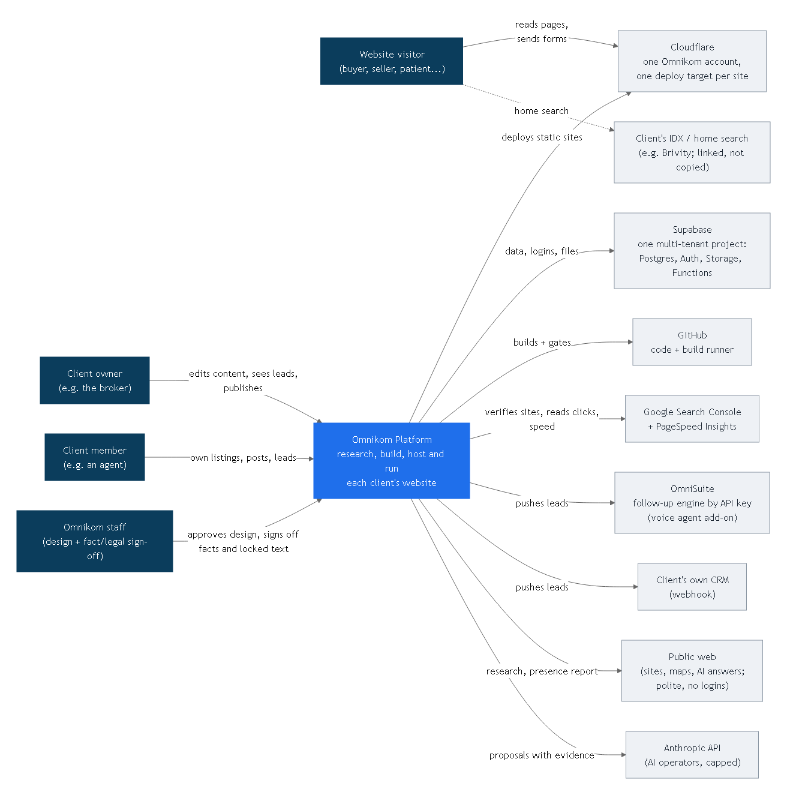
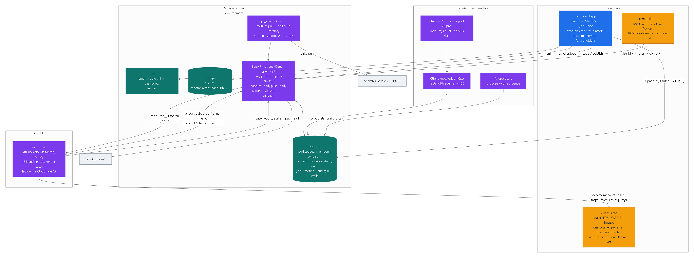
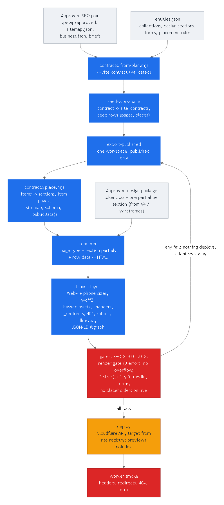
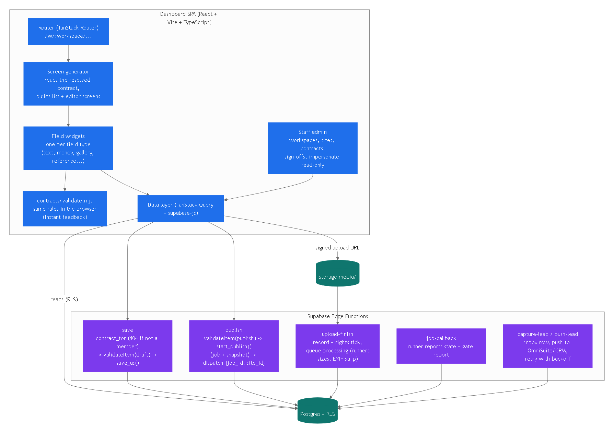
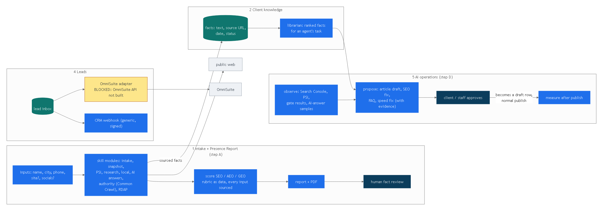
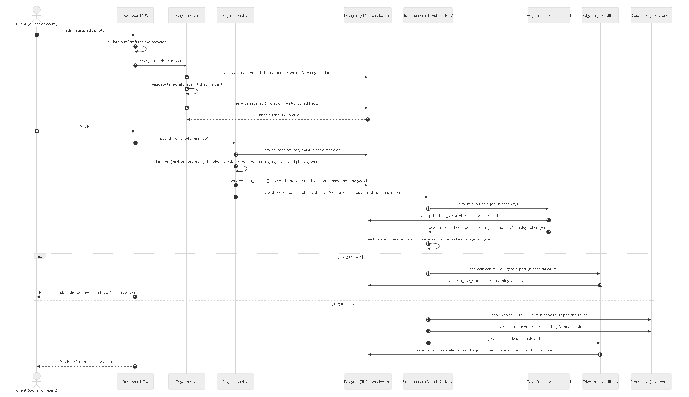
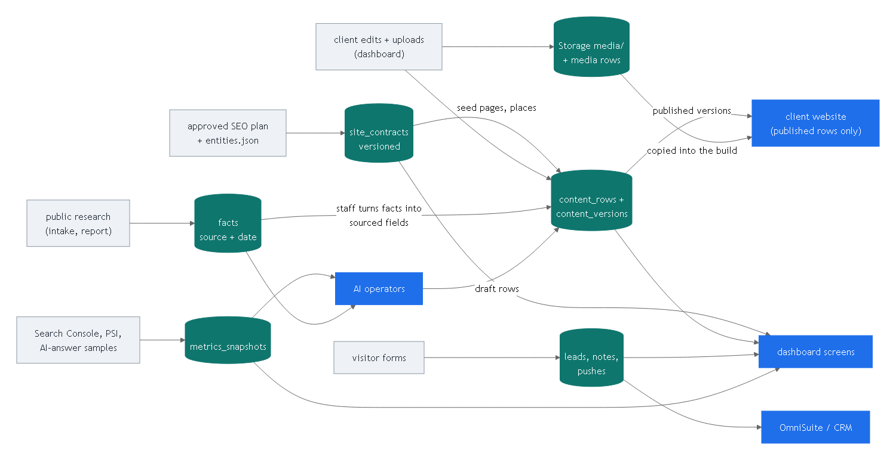
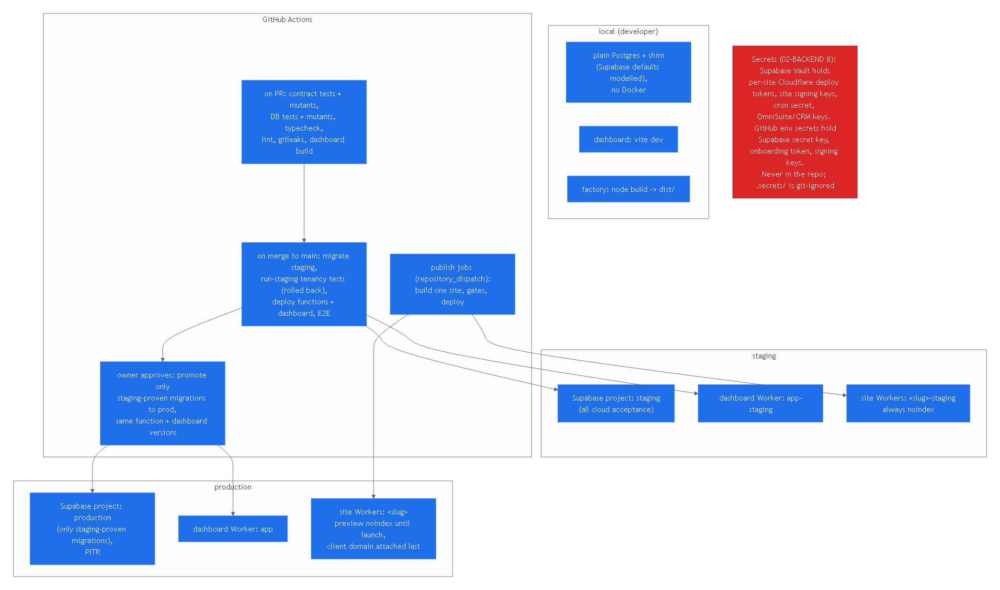
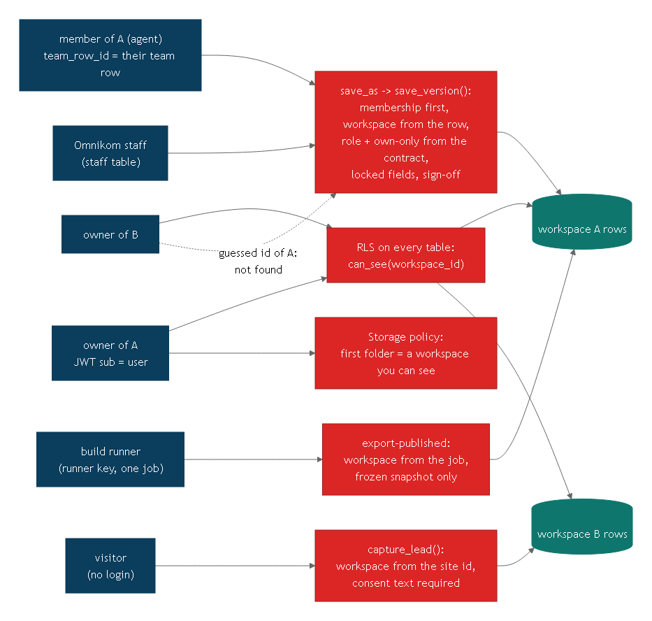

# 01 Architecture

Sources of truth: `planning/DECISIONS.md` (1-14, settled), `planning/TENANCY-AND-PUBLISHING.md`, `contracts/README.md`.
Diagrams: `diagrams/*.mmd` (source), `.svg` and `.png` (rendered by `node docs/blueprint/diagrams/render.mjs`).
Standards (`STANDARDS.md`): ISO/IEC/IEEE 42010:2022 (stakeholders and concerns 5.2.3, views and viewpoints 5.2.7, decisions and
rationale 5.2.12 / 6.10), the C4 model (https://c4model.com/diagrams), arc42 (https://arc42.org/overview).

## 0. Stakeholders, concerns, views (ISO/IEC/IEEE 42010:2022 5.2.3, 5.2.7) and arc42 map
| Stakeholder | Main concerns | Addressed in |
|---|---|---|
| Client owner / member | can I edit safely, are my leads mine, is my site fast and found | 04, 06 FR, 08 |
| Omnikom staff (owner Abdo) | one procedure for all industries, sign-offs, cost, no tenant leaks | 01, 05, 08, adr/ |
| Visitor | speed, clarity, privacy of what they send | NFR-2/3/9/10 |
| Build team | what to build first, how to know it is done | 05, 06, 09, 10 |
| Operator on call | detect and fix failures | 11 |
| Dave (CEO) | client relationship, cost | 05 RACI, NFR-11 |
Views (C4 core + supplementary): system context (2), container (3), component (4), dynamic: publish sequence (5), deployment (7);
plus data flow (6) and tenancy (8). arc42 map: 1 goals -> `06-PRD.md`; 2 constraints -> `planning/DECISIONS.md`; 3 context -> 2;
4 solution strategy -> 9; 5 building blocks -> 3-4; 6 runtime -> 5; 7 deployment -> 7; 8 crosscutting -> 8, `08-SECURITY.md`;
9 decisions -> `adr/`; 10 quality -> `06-PRD.md` NFR; 11 risks -> `05-BUILD-PLAN.md`; 12 glossary -> `planning/TENANCY-AND-PUBLISHING.md` 1.

## 1. What the platform does (one paragraph)
Omnikom researches and scores a business's online presence (the Presence Report), builds it a website that is correct for
search and AI answers from an approved SEO plan and an approved design, hosts it on Omnikom's Cloudflare account, and runs it from
a client dashboard: the client edits wording, posts articles, adds listings or products, sees leads and search numbers, and
presses Publish. Humans only approve the design and sign off facts and legal text on a private preview; the domain goes on last
(DECISIONS 2). Follow-up of leads runs on OmniSuite by API key (DECISIONS 1, 12). One procedure for every industry (DECISIONS 3, 14).

## 2. System context (C4 level 1)

| Actor / system | Relationship |
|---|---|
| Client owner | All of their workspace: content, leads, team logins, publish |
| Client member (agent) | Only what the contract allows, e.g. their own listings, posts and assigned leads |
| Omnikom staff | Every workspace; design approval; fact/legal sign-off; locked fields; every action audited |
| Visitor | Reads the static site; sends forms (lead + exact consent text recorded) |
| Cloudflare | One Omnikom account; one deploy target per client site; client keeps the domain (DECISIONS 7, 9) |
| Supabase | One multi-tenant project per environment: Postgres + RLS, Auth, Storage, Edge Functions, cron (DECISIONS 11) |
| GitHub | Code and the build runner (GitHub Actions: headless Chrome gates cannot run on Cloudflare's edge runtime) |
| Google Search Console / PSI | One Omnikom Search Console account for all sites (DECISIONS 11); speed from PageSpeed Insights |
| OmniSuite | Lead follow-up and voice agent by API key. **Its API does not exist yet** (DECISIONS 8): adapter BLOCKED |
| Client CRM | Generic signed webhook |
| Client IDX (e.g. Brivity) | Linked out, never copied (Example A LISTINGS-DECISION) |
| Anthropic API | AI operators (step D), with a per-workspace spend cap |

## 3. Containers (C4 level 2)

| Container | Technology | Responsibility |
|---|---|---|
| Dashboard app | React 18 + Vite + TypeScript SPA, TanStack Router/Query, supabase-js; hosted as a Cloudflare Pages project (`app`, DECISIONS 28) | Every client and staff screen; screens generated from the contract (`03-FRONTEND.md`) |
| Client sites | Static HTML/CSS/JS built by the factory; one Cloudflare Pages project per site (DECISIONS 28, `20-SHAPE.md` 3) | Public pages, `/api/lead` form endpoint (a Pages Function) forwarding to `capture-lead` |
| Postgres | Supabase Postgres 15+ | All tenant data; RLS on every table; content writes only via SECURITY DEFINER functions (`02-BACKEND.md`) |
| Auth | Supabase Auth | Magic link + password, invites; JWT `sub` drives RLS |
| Storage | Supabase Storage, private bucket `media` | Uploads under `<workspace_id>/`; copied into the site at build time |
| Edge Functions | Deno + TypeScript | save, publish, upload-finish, capture-lead, push-lead, export-published, job-callback, metrics pulls |
| Cron / queues | pg_cron + Supabase Queues (pgmq) | Lead push retries, daily Search Console / PSI pulls, sitemap submit, AI ops schedules |
| Build runner | GitHub Actions workflow `publish.yml` (repository_dispatch) | One site per job: export -> place -> render -> launch layer -> gates -> deploy -> smoke |
| Intake engine | Node `.mjs` over `skills/programmatic-enterprise-web-performance` | Presence Report (step A), runs on the Omnikom machine first |
| Client knowledge | Facts table (later) + librarian | Facts with source and date, feeding sourced fields and AI operators |
| AI operators | Node workers (step D) | Proposals with evidence become draft rows; normal publish path |

## 4. Components (C4 level 3)
**Website factory** (`03-FRONTEND.md` part A):

**Control center** (`03-FRONTEND.md` part B, `04-DASHBOARD.md`):

**Intake, knowledge, AI operations, lead adapter:**

## 5. Publish pipeline (sequence)

Rules the sequence enforces: a save never changes the live site; Publish creates a job holding a snapshot of exact versions and nothing goes live until that job is done; Publish validates in publish mode before anything builds; the
runner reads **one** job's frozen snapshot (runner key, scoped by the job); any gate failure deploys nothing and the client sees the
reason in plain words; the deploy target comes from the site registry, never from the request.

## 6. Data flow

## 7. Deployment and environments

| Environment | Supabase | Dashboard | Sites | Who deploys |
|---|---|---|---|---|
| local (no Docker, DECISIONS 15) | plain Postgres + `supabase/tests/local-shim.sql` (Supabase defaults modelled) via `supabase/dev-db.mjs`; functions through `serve-local.ts` (Deno) | `vite dev` | `node factory build` to `dist/` | developer |
| staging (testing) | Supabase project 1 of the one Omnikom account: every cloud acceptance runs here | Pages project `app-staging` | the site's Pages project, `preview` branch (`preview.<name>.pages.dev`), always noindex | CI on merge to `master` |
| production | Supabase project 2 (Free plan, no PITR; own nightly dumps, `11-OPERATIONS.md` 3): receives only migrations already proven on staging | Pages project `app` | the site's Pages project, production branch; noindex until launch; domain attached last | the owner-run `promote` workflow (`10-DELIVERY.md` 5); site deploys by publish jobs |

## 8. Security and tenancy

- **The wall is in the database** (TENANCY 2): RLS on every table (`can_see(workspace_id)`), content writes only through
  `service.save_as` -> `private.save_version` (no client can call it directly; workspace checked against membership and the row, role and own-only from the contract, locked fields, sign-off) and the publish
  functions (service role only). Proven locally: `node supabase/tests/run-local.mjs` (`02-BACKEND.md` section 9).
- **Builds** read through `export-published` with the runner key, scoped to one `publish_jobs` row (ADR 0011): workspace and site come from the job.
- **Visitors** reach the database only through `capture_lead()`: workspace from the site id, consent text required.
- **Storage**: first folder of every key is the workspace id; the policy uses `can_see()` on it.
- **Staff**: a `staff` table, not a client role; every save and publish is in `audit_log` with actor and time.
- **Secrets**: one list in `02-BACKEND.md` 8 (client integration secrets in Supabase Vault;
  the one Cloudflare deploy token and other CI-only keys in GitHub secrets, held by the runner); never in the repo (`.secrets/` is git-ignored; gitleaks in CI).
- **Deploy token (revised 2026-10-29, DECISIONS 28, `20-SHAPE.md` 3):** one account-level Cloudflare API token ("Cloudflare Pages:
  Edit", plus "Zone: DNS: Edit" for domain onboarding), held only by the runner as a GitHub secret. The runner takes the target
  project from the export's site row and refuses a mismatch; W1.6 tests that A's job cannot deploy to B. Per-site tokens are not
  used (per-project scoping of Pages tokens is UNVERIFIED; splitting into two tokens is an open item of `24-GAP-HUNT.md` B).
- **Personal data:** leads hold names, emails, phones; export and delete on request (owner action), retention policy is an open
  decision (`05-BUILD-PLAN.md` decisions).

## 9. Decisions this blueprint takes (small, reversible; change them in one place)
| Decision | Choice | Why |
|---|---|---|
| Deploy target per site | One Cloudflare **Pages project per site** (revised by DECISIONS 28, 2026-10-29; this reverses ADR 0002) | Pages project creation works again (`deploy-pages.mjs` created `example-a-omnikom-website`); preview deployments per branch, Pages Functions for `/api/lead`, custom domains from the account's zones (`20-SHAPE.md` 3) |
| Dashboard stack | React + Vite SPA on a Pages project; no server framework | All security is in Postgres (RLS + functions), so the app needs no server of its own; smaller attack surface (2026 framework RCEs, `~/.claude/reference/supply-chain-2026-10.md`) |
| Server code | Supabase Edge Functions (Deno) | Next to the data; one place for service-role code |
| Build runner | GitHub Actions | Gates need headless Chrome; free minutes; logs per job |
| Content storage | Generic `content_rows` + append-only `content_versions` (jsonb) checked by the contract | One schema for every industry (DECISIONS 3); no migration per new collection |
| Validation | `contracts/validate.mjs` runs in the browser (fast feedback) and in the Edge Functions (authority) | One rule set, already tested with 82 mutants |
