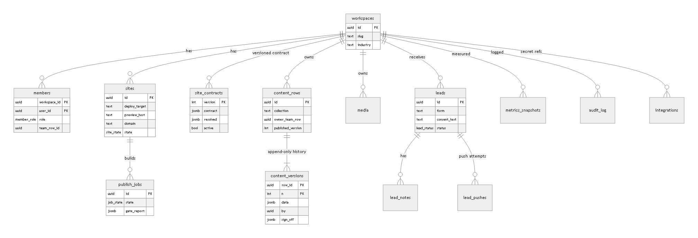

# 02 Backend

Everything server-side: Supabase (Postgres, Auth, Storage, Edge Functions, cron), the build runner, integrations, secrets, CI.
The schema is a tested draft: `supabase/migrations/20261028000001_platform.sql`, tests `supabase/tests/`.

## 1. Data model

| Table | Holds | Notes |
|---|---|---|
| `workspaces` | one row per client business | `slug`, `industry` |
| `staff` | Omnikom staff logins | not a client role; sees every workspace |
| `members` | login x workspace x role (`owner`, `member`) | `team_row_id` links a login to its row in the team collection (drives "own") |
| `sites` | site registry (TENANCY 3) | `deploy_target` (Worker name, unique), `preview_host`, `domain`, `deploy_token_ref` (Vault name of the per-site deploy token), `state` |
| `site_contracts` | the generated contract per workspace, versioned | `contract` (as generated), `resolved` = the whole contract with `collections` replaced by `mergeCore(contract)` (dry run 2, N17); one `active` |
| `content_rows` | one row per item (page, listing, article, notice...) | `collection`, `owner_team_row`, `published_version`, soft delete |
| `content_versions` | every save, append-only | `data jsonb` checked by `contracts/validate.mjs`; `sign_off` for locked changes |
| `media` | uploaded files | key must start with `<workspace_id>/`; `rights_confirmed` from the client; `width`, `exif_stripped`, `processed` set by the media processor (section 5) |
| `leads`, `lead_notes`, `lead_pushes` | the lead inbox | consent text copied at send time; every push attempt logged |
| `publish_jobs` | one per Publish | `rows` requested, `snapshot` {row: version} the build ships; state queued -> building -> gating -> deploying -> done / failed; gate report |
| `metrics_snapshots` | observed numbers per day | Search Console, PageSpeed, AI-answer samples, uptime; never invented |
| `audit_log` | who did what, when | every save, publish, sign-off, staff action |
| `integrations` | OmniSuite, CRM webhook, Search Console, IDX link per workspace | secret values in Supabase Vault, only a reference here |

Why one generic content table: the contract (not the schema) defines collections, so a new client or industry needs no
migration (DECISIONS 3). Queries by field use jsonb (`data->>'status'`); add expression indexes when a collection grows (e.g.
listings by status and area).

## 2. Auth and roles
- Supabase Auth: email magic link (default) and password; invites by the owner (members) or staff (owners). MFA for staff, enforced in the database: `private.is_staff()`
  is true only with the `aal2` claim (https://supabase.com/docs/guides/auth/auth-mfa); test T5 + a mutant. Invites need custom SMTP (D5).
- Roles: `owner`, `member` per workspace (`members`), `staff` platform-wide (`staff`). One person may belong to several workspaces.
- Helper functions used by every policy: `is_staff()`, `my_role(ws)`, `is_member(ws)`, `my_team_row(ws)`, `can_see(ws)`.
- The workspace in a request is a claim, never trusted alone: `save_version` checks it against the caller's membership and, for an
  existing row, requires it to equal the row's workspace; `capture_lead` takes it from the site; builds take it from the job.

## 3. Row-level security and grants (the wall)
Follows the Supabase RLS guide (https://supabase.com/docs/guides/database/postgres/row-level-security) and functions guide
(https://supabase.com/docs/guides/database/functions), checked 2026-10-28:
- RLS on every table; **every policy names its role** (`to authenticated`); `auth.uid()` wrapped as `(select auth.uid())`.
- **Supabase grants new tables and functions to `anon` and `authenticated` by default.** The migration turns the defaults off
  first (`alter default privileges ... revoke`) and then revokes explicitly: `anon` has no table rights and no function
  rights; `authenticated` has SELECT (RLS filters) and only the writes listed (members, media insert, lead notes, lead
  status/owner); no insert/update/delete on `content_rows` / `content_versions` at all.
- Schemas: `public` (exposed by the Data API: tables + `save_version`, the only client-callable function), `private` (helpers
  used by policies), `service` (service-only functions; usage granted to `service_role` only; never exposed).
- Storage: private bucket `media` created in the migration; SELECT/INSERT policies on `storage.objects` with `bucket_id = 'media'`
  and the first folder parsed by `private.try_uuid()` (a non-uuid folder is denied, not an error), then `private.can_see()`.
- The local tests run on a model of these defaults (`supabase/tests/local-shim.sql`); without the model the tests passed walls that
  leak on Supabase (found by the fact-check, 2026-10-28). The authority is the same test file on a real project (W0.3).
Deviation: definer functions pin `search_path = public` instead of the guide's `''` (`STANDARDS.md`, fix in W0.3).

## 4. Content writes, versions, publish (mirrors `contracts/store.mjs`; the database adds jobs)
| Function | Called by | Does |
|---|---|---|
| `private.save_version(...)` | nobody directly: only through `service.save_as` | the save rules: non-members `S-NOT-FOUND` first, unknown collection, members on `none` collections `S-ROLE`, other people's items `S-OWN-ONLY` (owner field filled from the login), locked fields `S-LOCKED` / staff `S-SIGNOFF`, singleton; appends version n+1; audit |
| `service.save_as(claims, ws, collection, row, data, sign_off)` | Edge fn `save`, after verifying the JWT and running `validateItem` | applies the verified claims for the transaction, then `private.save_version`. There is **no client-callable save RPC**, so the validator cannot be skipped (dry run 3.2) |
| `service.seed_version(ws, collection, data, actor)` | `seed-workspace` (W1.1), staff onboarding | explicit staff actor (`S-SEED-ACTOR`); version 1 by the actor; sets locked page fields from the plan |
| `service.start_publish(claims, site, rows[], versions[])` | Edge fn `publish`, after `validateItem` (publish) | one atomic job for all rows; the caller must be allowed to touch each row (members: own items only, `S-OWN-ONLY`; `none` collections `S-ROLE`); rows must belong to the site's workspace; no inbox rows; records the validated versions it was given (never "latest at this moment"); **moves nothing** |
| `service.freeze_snapshot(job)` | Edge fn `export-published` | at build start: snapshot = what is live now + this job's requested versions; queued -> building. Freezing at build start (not at publish) matters because builds of one site run one at a time: a later job must include what an earlier job made live |
| `service.published_rows(job)` | Edge fn `export-published` | exactly the frozen snapshot, so a rerun ships the same content |
| `service.set_job_state(job, state, report, deploy)` | Edge fn `job-callback` | legal transitions only (`S-JOB-STATE`); `done`: the job's rows go live at their snapshot versions; `failed`: nothing changes, and the failed versions are never shipped by a later job; one `publish_job_events` row per state |
| `service.reap_stale_jobs()` | pg_cron every 5 min | counted from the **last state change** (N2): building/gating/deploying idle 30 min, queued idle 24 h -> failed (reason `timeout`); if the deploy lands anyway, `done` reconciles the reaped job |
| `service.contract_for(claims, ws)` | `save`, `publish` | the resolved contract, only to members and staff (S-NOT-FOUND otherwise) |
| `service.unpublish(claims, row, delete)` | Edge fn `unpublish` (owner/staff) | takes a row off the site (and optionally soft-deletes it); live with the next publish |
| `service.capture_lead(site, form, page, ..., consent)` | Edge fn `capture-lead` | workspace from the site; consent text required |
Reference semantics for `validateItem(... exists)`: a draft may reference any row of the workspace; publish requires the
referenced row to be live or in the same job. Photos: `validateItem` gets a `media(asset)` lookup from the `media` table, so
width, EXIF and rights come from the record, never from the row JSON (`I-MEDIA-UNKNOWN` for an unknown file). Contracts: the
export carries `contract` (as generated); `resolved` (core merged, used by SQL) is also safe to validate against because
`mergeCore` is idempotent (tests in `contracts/test/run.mjs`). Service functions are reached over a direct Postgres
connection from the Edge Functions (exact default variable name UNVERIFIED until W1.2); delete = `unpublish(..., true)` plus a
301 for collections with `onDelete`.

## 5. Storage and photo rules
1. `upload-start` (user JWT) returns a signed upload URL under `media/<workspace_id>/<uuid>.<ext>` (jpg, png, webp, heic; PDF for
   documents; max 25 MB). The bucket and its policies are in the migration (section 3).
2. `upload-finish` (user JWT) records the media row (`processed = false`), the rights tick and alt text, and **queues** processing.
3. **Processing runs in the GitHub runner (`media.yml`, sharp), not in an Edge Function**: Edge Functions have 2 s CPU time, 256 MB
   memory and do not support libvips/sharp (https://supabase.com/docs/guides/functions/limits). The runner downloads the original, strips EXIF/GPS, writes 2400 / 1600 /
   800 px WebP, and calls `media-process-callback` (runner signature), which sets width, height, `exif_stripped`, `processed`.
4. Publish refuses photos without alt text, below the field's minimum width, without the rights tick, or not processed
   (`I-ALT`, `I-MEDIA-SIZE`, `I-RIGHTS`, `I-EXIF`).
5. The build copies only the media a snapshot row references; the bucket is never public.
Before adding sharp or any library: `~/.claude/reference/supply-chain-2026-10.md` (pinned version, lockfile, 7-day rule).

## 6. Edge Functions (Deno, TypeScript; shared code imports `contracts/*.mjs`)
Machine-call signature (N6): header `t=<unix>,v1=<hex>` with v1 = HMAC-SHA256(key, `t \n METHOD \n path?query \n body`), accepted for
300 s; method, path and query are signed, so a signature for one job is useless for another (`supabase/functions/_shared/signature.ts`,
tests `signature.test.mjs`, watched failing on a wider window and on unsigned paths).
Keys: new projects use Supabase's **publishable** key (dashboard) and **secret** key (server); the legacy `anon`/`service_role`
keys are being deprecated by the end of 2026 (https://supabase.com/docs/guides/api/api-keys). Functions called by machines have no
user JWT, so they run with `verify_jwt = false` (`supabase/config.toml`) and **verify their own credential in code first**
(https://supabase.com/docs/guides/functions/auth). Limits that shape the design (https://supabase.com/docs/guides/functions/limits): 2 s CPU, 256 MB, 150 s request
idle timeout.
| Function | Caller and credential | Steps | Fails how |
|---|---|---|---|
| `save` | dashboard, user JWT (verify_jwt on) | **`service.contract_for` first** (404 for non-members, before any validation could reveal field names or limits; N1) -> `validateItem(draft)` with the media lookup -> `service.save_as` | 422 codes + plain words; 403 walls; 409 `S-SINGLETON` |
| `publish` | dashboard, user JWT; body `{site, rows[], versions[]}` (N8) | `service.contract_for` first (404) -> `validateItem(publish)` on exactly the given versions -> `service.start_publish` **pins those versions** (N4) -> GitHub `repository_dispatch` with `client_payload {job_id, site_id}` (dispatch credential, section 8) | 422; 404; 202 queued |
| `upload-start`, `upload-finish` | dashboard, user JWT | section 5 | 413, 415 |
| `export-published` | runner, `X-Runner-Signature` (runner key; ADR 0011), verify_jwt off | `service.freeze_snapshot(job)` -> `service.published_rows(job)` + `contract` + media list + the site's deploy target, the Worker its token is scoped to, and the token from Vault | 401 |
| `job-callback` | runner, `X-Runner-Signature` (HMAC of the body), verify_jwt off | `service.set_job_state` (409 on an illegal transition); notify the requester; on `done` for a live site -> `sitemap-submit` | 401, 409 |
| `unpublish` | dashboard, user JWT (owner/staff) | `service.unpublish` | 404 |
| `media-process-callback` | runner, `X-Runner-Signature`, verify_jwt off | set width, height, `exif_stripped`, `processed` | 401 |
| `capture-lead` | site Worker, `X-Site-Signature` (HMAC with that site's signing key), verify_jwt off | honeypot + rate limit per IP/site -> `service.capture_lead` -> queue push -> email alert | 400 (consent), 401, 429 |
| `push-lead` | pg_cron/queue, internal cron secret, verify_jwt off | OmniSuite adapter (BLOCKED until its API exists) or signed CRM webhook; retries 1m/5m/30m/2h; `lead_pushes` row per try | after 4 tries: failed, owner sees it |
| `metrics-pull` | pg_cron, internal cron secret, verify_jwt off | cron enqueues **one message per workspace**; each call handles one workspace (Search Console + PSI) and finishes well under the 150 s idle timeout | retried next day |
| `sitemap-submit` | job-callback, internal secret | Search Console sitemap submit for live sites | logged |
pg_cron calls functions through pg_net with the cron secret read from Vault; pg_net keeps request headers in
`net.http_request_queue`, so the cron secret is a dedicated low-privilege internal secret, never the Supabase secret key.

## 7. Build runner (GitHub Actions `publish.yml`)
`on: repository_dispatch` (type `publish`; GitHub runs it from the default branch). `client_payload` = `{ job_id, site_id }`;
`concurrency: { group: site-${{ github.event.client_payload.site_id }}, queue: max }`: one build per site, up to 100 waiting, none
replaced (concurrency is evaluated before any step, from the payload; GitHub concurrency docs). `site_id` is used only as the
concurrency key: the runner fetches the export (runner key) and **refuses if the export's site differs from `site_id`, or if the deploy target differs from the Worker recorded with that site's token at onboarding** (W1.6).
Steps: checkout -> `npm ci` -> `export-published` -> `node factory/build.mjs` -> launch layer -> gates (`03-FRONTEND.md` A5) ->
`wrangler deploy` to the export's target with the export's per-site token (masked in logs) -> smoke test -> `job-callback`.
`media.yml` (repository_dispatch type `media`) processes queued photos (section 5).

## 8. Secrets (the single list; every other doc points here)
| Secret | Lives in | Used by | Scope | Rotation |
|---|---|---|---|---|
| Supabase secret key (`sb_secret_...`), per environment | GitHub environment secret (CI migrations) + function environment | CI, Edge Functions | bypasses RLS: server only | 90 days or staff change |
| Supabase publishable key | dashboard build config (public by design) | dashboard | RLS applies | on compromise |
| Database connection for `service` functions | function environment (platform default) | Edge Functions | per environment | managed by Supabase |
| **Cloudflare deploy token per site** (account-owned; Editor on that site's Workers) | **Supabase Vault**, named in `sites.deploy_token_ref`; the secret is JSON `{ "token": ..., "worker": "<Worker name it is scoped to>" }` (N7); the export returns `deployToken` + `deployTokenWorker` | `export-published` hands it to the runner for that one job | one site (its staging + prod Worker) | 90 days |
| Cloudflare onboarding token (Workers Admin; later Zone/DNS/Zone Settings Edit) | GitHub environment secret, staff-only workflow | create a site's Workers, mint its deploy token | account | 90 days |
| GitHub dispatch credential (GitHub App installation token or fine-grained token, this repo only) | function environment (`publish`) | `repository_dispatch` | this repo; exact fine-grained permission UNVERIFIED (classic tokens need `repo`) | 90 days |
| Runner key (signs runner -> function calls) | function environment + GitHub environment secret | `export-published`, `job-callback`, `media-process-callback` | per environment; the runner is trusted (ADR 0011) | 90 days |
| Site signing key (one per site) | site Worker secret + Vault | site `/api/lead` -> `capture-lead` | one site | on staff change |
| Internal cron secret | Vault (read by pg_cron) + function environment | `push-lead`, `metrics-pull`, `sitemap-submit` | internal only | 90 days |
| OmniSuite keys, CRM webhook secrets | Vault, per workspace | `push-lead` | one workspace | provider policy |
| Google credentials (Search Console, PSI), Anthropic key | Vault (platform) | `metrics-pull`, AI ops | platform | provider policy |
Local developer keys stay in `.secrets/` (git-ignored, `sops/credentials.md`). gitleaks runs in CI on every PR.
**Scale limits (Cloudflare, checked 2026-10-28):** 500 Workers per account on the paid plan and 500 account API tokens
(https://developers.cloudflare.com/workers/platform/limits/, https://developers.cloudflare.com/fundamentals/api/reference/limits/).
With a staging and a prod Worker per site in one account that is about 249 sites; staging goes to its own account before that,
and Workers for Platforms is the path past it (risk register, `05-BUILD-PLAN.md`).

## 9. Tests that can fail (run on any machine with Postgres 15+)
`node supabase/tests/run-local.mjs` creates a throwaway cluster, applies `local-shim.sql` (a model of Supabase: `auth.uid()`,
`auth.jwt()`, **Supabase's default grants to anon/authenticated**, a minimal `storage` schema, the `supabase_realtime`
publication) and the migration, runs `tenancy.test.sql` (one rolled-back transaction: T0 seeding; T1 locked field; T2 own-only,
owner field from the login, members publish only their own; T3 cross-client read/edit/write/upload/publish; T10 storage objects;
T4 append-only, no path around the validator, service functions closed; T5 staff need aal2 + sign-off; T6 publish job, nothing live
before done, a failed publish never ships with the next one, legal transitions, state events; T11 two queued jobs, rerun ships the
frozen snapshot, reaper, unpublish, Realtime; T7 leads; T9 anonymous callers), then the **mutants**, each removing one wall (both
layers where a wall is double); every mutant must make the tests fail. All inputs are read once at the start.
Proof that the shim matters: with the earlier shim (no Supabase defaults) the three grant-wall mutants SURVIVED; with the model
they are caught (PROGRESS.md).

## 10. Status
See `PROGRESS.md` for the latest run output. UNPROVEN until run on a real Supabase project: Storage policies, Edge Functions,
pg_cron, Vault (none exist yet; the owner creates the projects, `05-BUILD-PLAN.md` decisions).

## 11. CI (`.github/workflows/ci.yml`, to write in W0.2)
On PR: `node contracts/test/run.mjs`, `node contracts/test/mutate.mjs`, `node supabase/tests/run-local.mjs` (Postgres
binaries installed on the runner; the script starts its own cluster), dashboard `tsc --noEmit`, lint, unit tests, `vite build`, gitleaks. On merge: `supabase db push` to staging, run
`tenancy.test.sql` there, deploy dashboard to staging. Production: same with a manual approval.
