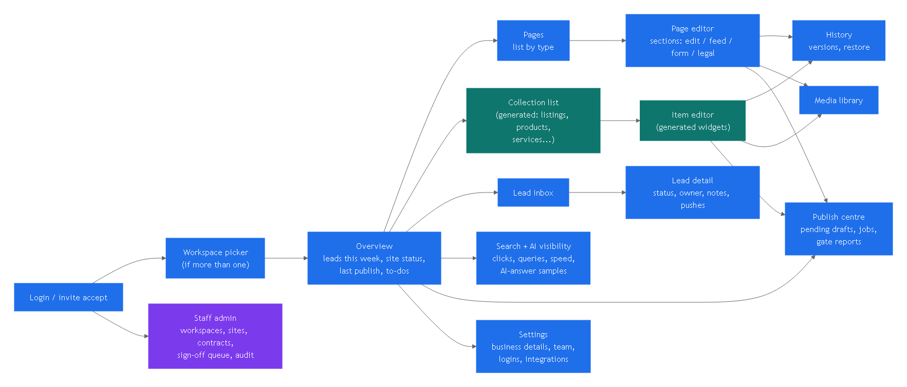
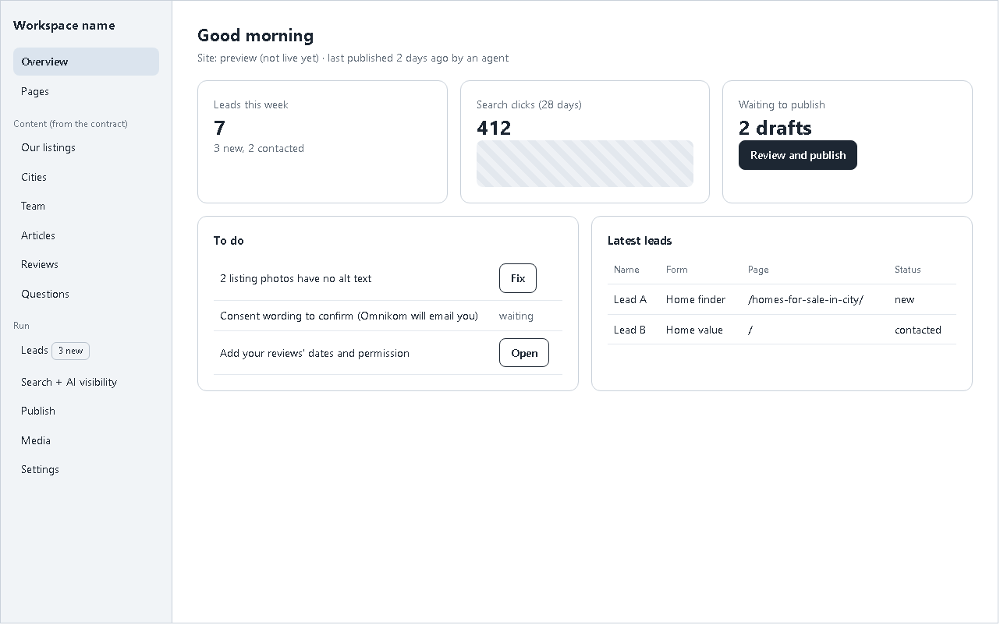
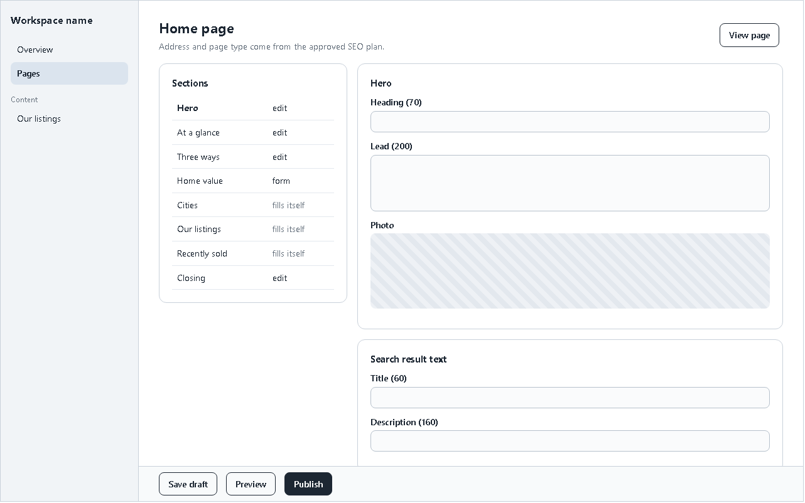
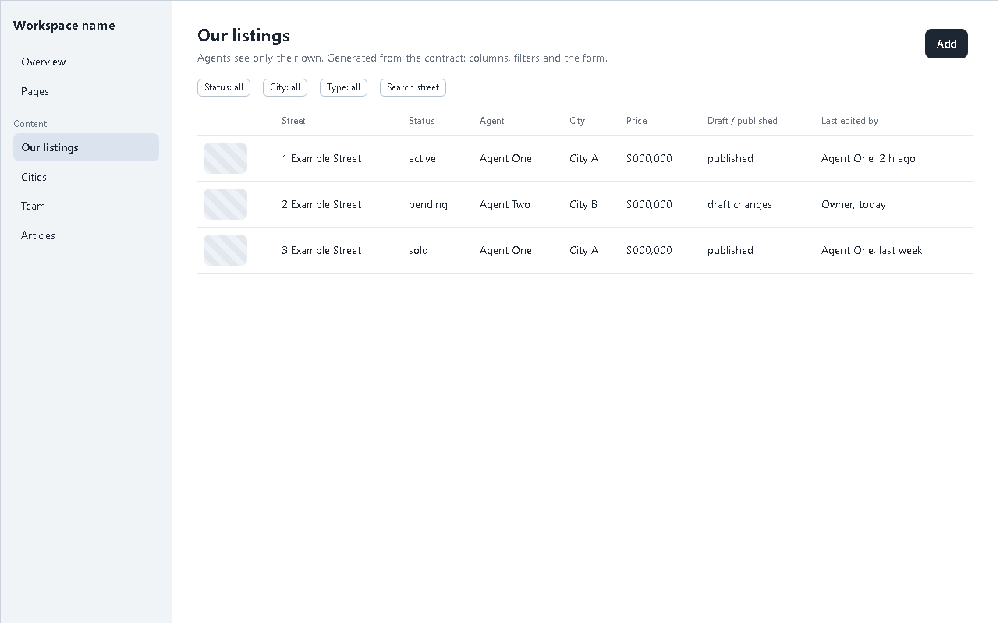
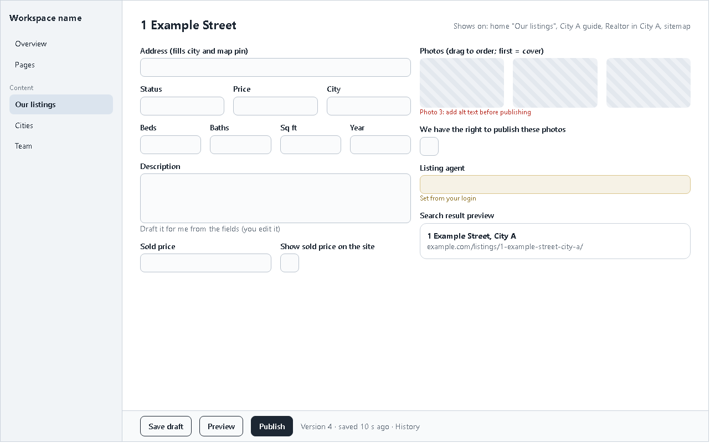
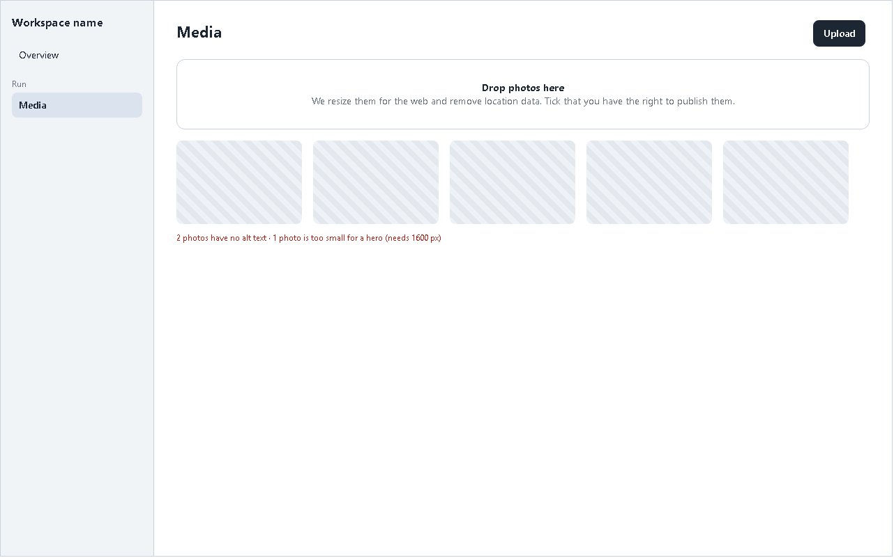
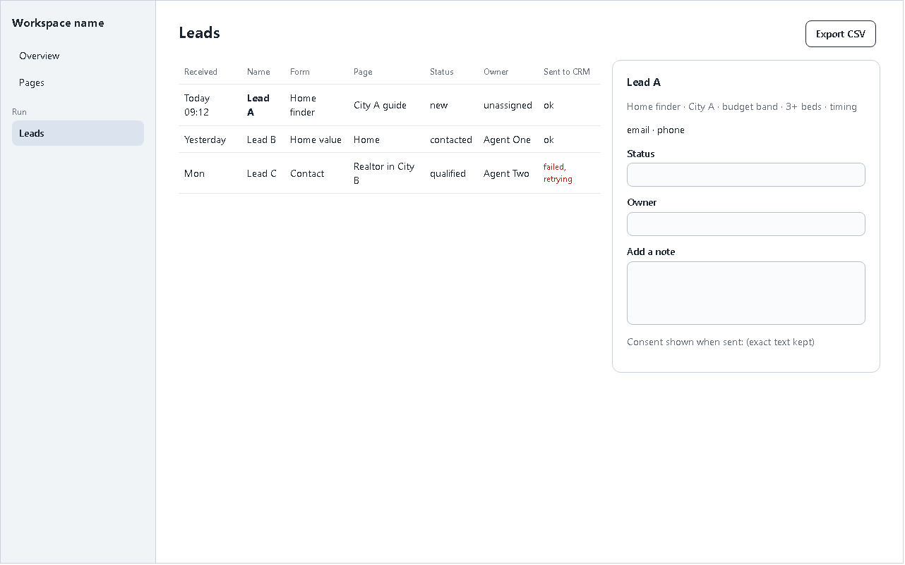
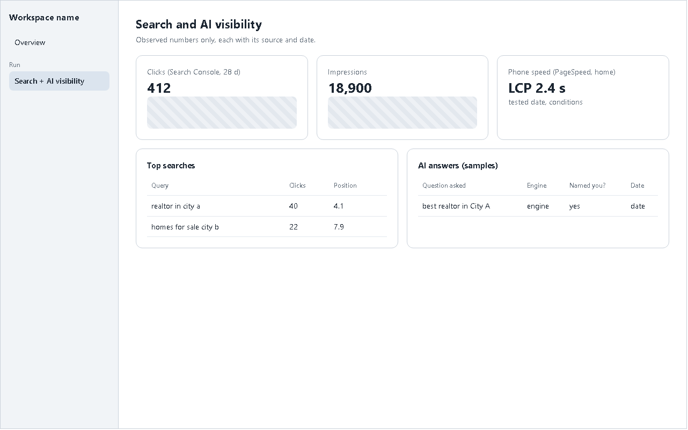
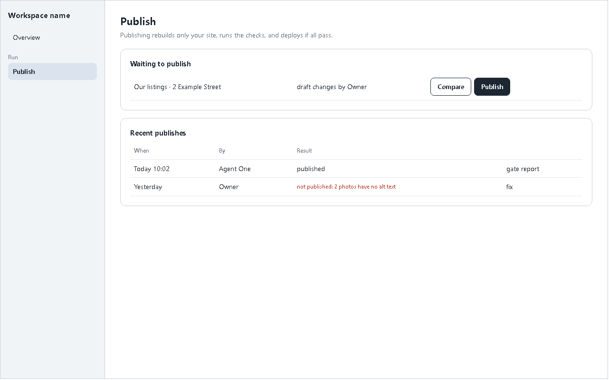
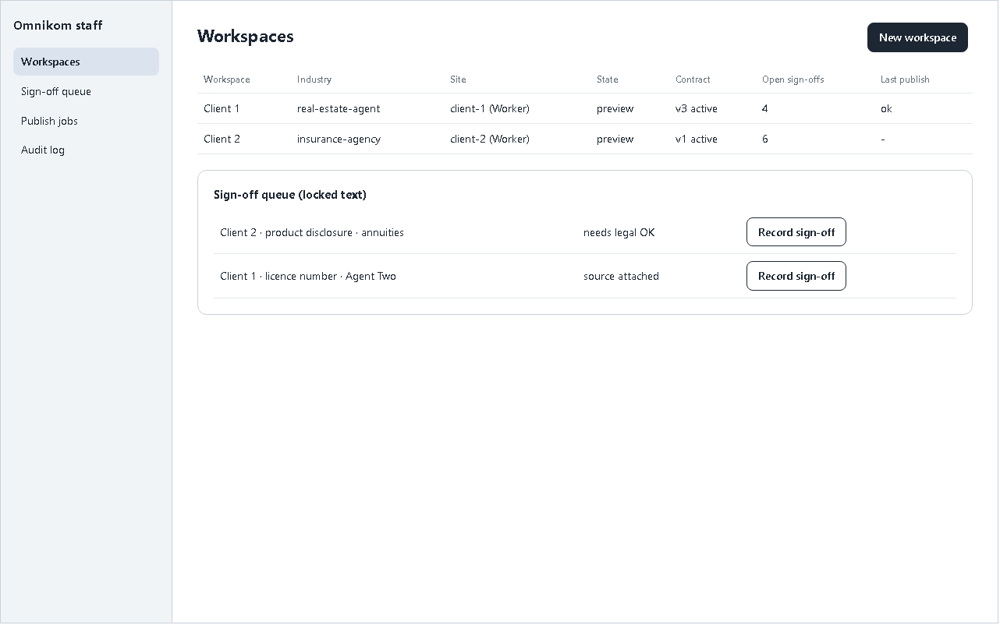

# 04 User dashboard: every screen and flow

Wireframes: `wireframes/wireframes.html` (open in a browser; `?s=<id>` shows one screen), rendered PNGs next to it
(`node docs/blueprint/wireframes/render.mjs`). They fix **structure and content**, not the look: the visual design follows the
owner's rules (`03-FRONTEND.md` B5) and gets its own design pass. Numbers and names in them are placeholders.
The exact fields of each generated screen per site: `contracts/examples/<site>/screens.md`; per industry:
`contracts/industry-run/screens/<industry>.md`.

## Screen map

## Roles and what they see
| Screen | Owner | Member (agent) | Staff |
|---|---|---|---|
| Overview, Visibility | yes | yes (their leads only in counts) | yes, any workspace |
| Pages | edit + publish | read | edit; change page list only via a new contract version |
| Collections | all rows | where the contract says `own`: their rows; `none`: hidden | all |
| Media | all | own uploads + use any | all |
| Leads | all | assigned to them | all |
| Settings: business, team, logins | yes (locked fields read-only) | own profile | yes + locked fields with sign-off |
| Settings: integrations, site | read | no | edit |
| Staff admin | no | no | yes |

## Screens
### 1. Login, invite, reset
Email magic link by default, password optional; an invite is a sign-in link; it lives 10 minutes; the person can ask for a new one at
/login (owner 2026-10-31: one link life of 600 s, `mailer_otp_exp`; settled 2026-11-01); staff need MFA. After login: last workspace, or the
picker if the person belongs to more than one.

### 2. Overview `/w/:ws` 
Site state (preview / live, last publish, by whom), leads this week, search clicks (28 days, from `metrics_snapshots`), drafts
waiting to publish, a to-do list built from real checks (publish-blocking problems, `clientWording` items still to confirm, failed
lead pushes), latest leads.

### 3. Pages `/w/:ws/pages` and page editor 
List grouped by page type with counts (ELEV8: home 1, Realtor in <city> 10, city guides 10, sell in <city> 9...). Editor: left the
page type's sections in order; "edit" sections open their generated fields; "fills itself" sections say from which collection and
by which rule ("active listings in this city, newest first"); form sections show the form and where answers go; legal sections show
the locked text. Search-result text (title 60, description 160) with a live preview. Publish bar at the bottom.

### 4. Collection list (generated) 
Columns: title field, status field, owner field, draft/published, last edited by; filters from enum and reference fields;
search; "Add". Members on `own` collections see only their rows (enforced by the database, not by hiding).

### 5. Item editor (generated) 
Widgets per field type (`03-FRONTEND.md` B4); errors next to the field in plain words with the rule code underneath for support;
"Shows on" line computed from the placement rules; locked fields read-only with the reason; owner field filled from the login;
publish bar: Save draft, Preview (the item rendered with the site's partials), Publish, History (versions, compare two versions,
restore = new version).
**Flow, ELEV8 agent adds a listing:** Our listings -> Add -> address (fills city + pin) -> status, price, beds, baths, sqft, lot,
year, type -> description (optional "draft it for me" from the fields; the agent edits) -> photos (drag in, order, cover, alt
suggested, rights tick; upload strips EXIF and makes sizes) -> Preview -> Publish -> the job rebuilds the listing page, home "Our
listings", the city guide, "Realtor in <city>", sitemap -> "Published" with the link. Status change is one click and publishes the
same way. Delete: the page 301s to its city guide.

### 6. Media 
Upload (drag, bulk), grid with problems flagged (no alt, too small for its use, no rights tick), where each file is used, replace
everywhere, delete only when unused.

### 7. Leads 
Inbox newest first; columns received, name, form, page, status, owner, push result; detail panel with answers, status, owner,
notes, exact consent text, push attempts and a "resend" button; CSV export. New lead: realtime row + email alert to the owner
(and the assigned agent). Push to OmniSuite (BLOCKED until its API exists) or the client CRM webhook.

### 8. Search and AI visibility 
Search Console clicks, impressions, top queries and pages; PageSpeed (phone + desktop) with test date and conditions;
AI-answer samples (question, engine, whether the business was named, date). Observed values only, each with source and date
(ANALYSIS 4); nothing is scored without its inputs.

### 9. Publish centre 
Drafts waiting (compare with the published version, publish one or all), recent publish jobs with result and the gate report in
plain words ("2 photos have no alt text" with a Fix link), rollback of the whole site to a previous deploy (staff).

### 10. Settings
Business details (name, phone, email, address, hours, socials; legal name, licences and footer notice locked), Team (people and
their logins; invite, remove, which team row a login is), Logins (owner manages members), Integrations (CRM webhook URL + test,
OmniSuite status, IDX link), Site (preview link, domain status, live/preview; staff edit).

### 11. Staff admin 
Workspaces (create from an approved plan: runs `from-plan`, loads the contract version, seeds rows, creates the site registry
row), sign-off queue (locked text and facts waiting for a recorded sign-off with source), publish jobs across all sites, audit log,
read-only "view as" a workspace.

## Flows across screens
| Flow | Steps | Ends in |
|---|---|---|
| Onboard a client (staff) | approved plan + entities.json -> New workspace -> contract v1 active -> seed rows -> invite owner -> first publish to preview | preview link for design approval + fact/legal sign-off (DECISIONS 2) |
| Client review email | `clientWording` + open sign-offs -> one email drafted for staff to send (owner click, CLAUDE.md 6) | answers fill locked notices with sign-off |
| Go live | all sign-offs recorded -> staff sets domain -> live deploy guard (no noindex, no placeholders) -> Search Console verify + sitemap submit | site state live |
| Post an article | Articles -> Add -> title, excerpt, cover, body, author, date, SEO -> Publish | article page + blog index + sitemap |
| Change locked text | client asks -> staff edits with sign-off ref -> publish | audit row with sign-off |
| A lead arrives | form -> capture-lead -> inbox + alert -> push to CRM -> agent updates status | lead closed or spam |
