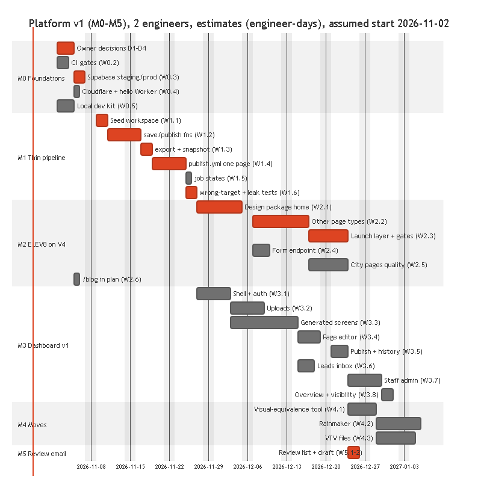

# 05 Build plan

Order agreed with the owner (2026-10-28): (1) thin end-to-end pipeline, (2) Example A's 42 pages on the approved V4 design with the
launch gates, (3) dashboard v1, (4) move Example D and Example C with visual-equivalence checks, (5) Example A client review email.
Later tracks: leads to OmniSuite, metrics, Presence Report engine (step A), AI operators, self-serve.

## Rules for every work order
- **Done means observed**: the acceptance command ran and its output says so, or the page rendered and was looked at. Paste the
  output into the PR. Write NOT DONE / UNPROVEN / BLOCKED plainly.
- **Every new test is watched failing**: break the code it covers, see it red for the right reason, restore (the repo already does
  this mechanically: `contracts/test/mutate.mjs`, `supabase/tests/run-local.mjs` mutants). New rules add a mutant.
- Client content never crosses workspaces or projects; never submit forms on a client's live site; no paid data APIs.
- Outward actions (sending email, DNS changes, publishing live, payments) need the owner's click.
- Before adding any dependency: `~/.claude/reference/supply-chain-2026-10.md` (pinned versions, lockfile, 7-day rule).

## Target repo layout
```
contracts/            done: contract, validator, store model, placement, screens, tests (keep as is)
supabase/             migrations/, tests/ (done: core schema + tenancy tests), functions/<name>/index.ts
factory/              build.mjs, render/, launch/, gates/ (lift from E:\Example C\site-src + tests)
sites/<slug>/         entities.json, design/ (tokens.css, sections/*.mjs, item/*.mjs, shell.mjs), worker/ (form endpoint)
apps/dashboard/       React + Vite SPA
.github/workflows/    ci.yml, publish.yml, deploy-dashboard.yml
docs/blueprint/       this package
```

## M0 Foundations
Every acceptance has a **cloud** form (the real one) and a **local** form that proves the same rule without any account
(milestones M0-M1 were built this way by an independent dry run on 2026-10-28). Local needs: Node 20+, Deno 2, Postgres 15+
binaries on PATH, no Docker.
| WO | Work | Acceptance, cloud (must be able to fail) | Acceptance, local (no accounts) | Needs |
|---|---|---|---|---|
| W0.1 | Owner decisions D1-D4 | written in `planning/DECISIONS.md` | same | owner |
| W0.2 | CI `ci.yml`: contract tests + mutants, DB tests + mutants (**Postgres binaries installed on the runner**, not a service container: `run-local.mjs` starts its own cluster), spec check, gitleaks, commit-lint | a PR that breaks one rule goes red in CI (show the run) | `node docs/blueprint/specs/run-all-gates.mjs` exits 0, and exits 1 after breaking one rule | GitHub repo |
| W0.3 | One Supabase account, two projects (DECISIONS 15): **staging** and **production** (publishable + secret keys); `supabase link` + `supabase db push` to staging only; `search_path = ''` in definer functions; production gets the same migration only through the promotion step (`10-DELIVERY.md` 5) | `STAGING_DB_URL=... node supabase/tests/run-staging.mjs`: PASS on staging with Supabase's real auth, defaults and Storage, and "no fixtures left" (one rolled-back transaction); an upload into another workspace's folder is refused through the Storage API | `node supabase/tests/run-local.mjs`: real migration passes, every mutant caught (Supabase defaults modelled in `local-shim.sql`) | D1 |
| W0.4 | Cloudflare: onboarding token (GitHub env secret); reproduce Pages project creation once and save the raw error + the token's permissions (ADR 0002); a hello Worker + its per-site deploy token (Editor on that Worker) in Vault, recorded with the Worker name it is scoped to | the URL serves the file with `X-Robots-Tag: noindex`; the per-site token cannot deploy a second Worker (expect 403) | `wrangler deploy --dry-run` builds the bundle; the runner refuses a target that differs from the token's recorded Worker (unit test) | D2 |
| W0.5 | Local dev kit: root `package.json` + lockfile (npm workspaces), `supabase/dev-db.mjs` (creates `omnikom_local` from shim + migration on local Postgres), a Docker-free functions runner (`supabase/functions/serve-local.ts`, Deno, calling the `service` functions over a direct connection); persistent local Postgres: `dev-db.mjs` keeps its data in `.localdb/` (git-ignored) on port 54329 and creates a local staff login (`staff@local.test`; dev tokens carry `aal2`); root `package.json` + `deno.json` with `"nodeModulesDir": "none"` (both exist now: with a root `package.json`, `deno check` of the shared contracts module fails on `npm:@types/node` until that setting is present; watched red then green, N5); DB driver for the direct connection: postgres.js pinned in the import map (supply-chain rule, N16) | n/a | `npm ci` works from a clean clone; `deno task check` passes; `node supabase/dev-db.mjs` then `deno task serve-local` answers `save` with 401 without a JWT | none |

## M1 Thin end-to-end pipeline (one page, real path)
| WO | Work | Acceptance, cloud | Acceptance, local | Needs |
|---|---|---|---|---|
| W1.1 | `supabase/seed-workspace.mjs` (flags: workspace name, deploy target, preview host until D3): contract (from `from-plan`) -> `site_contracts` (`contract` as generated + `resolved` = core merged; idempotency key = sha256 of the canonical JSON of both inputs); pages seeded from the contract's `pageSeeds` (plan pages from the sitemap; pages outside the plan from `entities.pageSeo`, each with its source; `seedGaps(contract)` must be empty, N3) and places (slug, name = the plan's `location` city) through `service.seed_version` with a staff actor (seeding sets the locked path/type; reference = sitemap sha256); `sites` row | Example A on staging: 43 page rows, 10 places, 1 site; `seedGaps` empty; a re-run changes no counts and adds no contract version | same on `omnikom_local` | W0.3 / W0.5 |
| W1.2 | Edge fns `save` (verify JWT -> `service.contract_for`, 404 for non-members **before** any validation -> `validateItem` with the media lookup -> `service.save_as`) and `publish` (body `{site, rows, versions}`: verify JWT -> `contract_for` -> `validateItem(publish)` on exactly those versions -> `service.start_publish` with the versions pinned -> dispatch); `supabase/functions/_shared/signature.ts` for machine calls | an outsider's save into another workspace -> 404 with no field names in the body; invalid save -> 422 with `I-` codes; incomplete publish -> 422; an agent's save or publish of another agent's listing -> 403 `S-OWN-ONLY`; a direct call to the save body is refused (no RPC path exists) | same against `serve-local.ts`; `tenancy.test.sql` T2/T2b/T4 | W0.3 / W0.5 |
| W1.3 | `export-published` authenticated by the runner key (ADR 0011): `service.freeze_snapshot` + `service.published_rows` + the site's deploy target and token | export for job A contains no id of workspace B; a bad signature -> 401; a rerun returns the same snapshot | same locally with two seeded workspaces (Example A + `industry-run/contracts/real-estate.json`); T6/T11 | W1.2 |
| W1.4 | `publish.yml` (payload `{job_id, site_id}`, concurrency per site, `queue: max`): export -> `place()` -> render the **contact** page (no required image; photos arrive in M3) -> **M1 gate** `factory/gates/m1-gate.mjs` (one h1, title, no placeholder, preview noindex; `--force-fail` for the test) -> deploy with the per-site token -> smoke | change the contact heading, publish, the preview shows it; with `--force-fail` nothing deploys, the job is `failed`, and the next unrelated publish does not ship the failed heading | same with the runner script run locally and the deploy step replaced by writing `dist/` (no Cloudflare); T6 covers the failed-content rule in SQL | W1.3, W0.4 |
| W1.5 | `job-callback` -> `service.set_job_state` (legal transitions only; one `publish_job_events` row per state); `publish_jobs` + `leads` in the `supabase_realtime` publication; pg_cron runs `service.reap_stale_jobs` every 5 min | the dashboard receives queued -> building -> gating -> deploying -> done in order; a skipped state -> 409 | events table shows the 5 states with times; T6 illegal jump; reaper test (job older than 30 min -> failed) | W1.4 |
| W1.6 | Wrong-target + leak tests | a copy of the database in which B's site row is first moved to a placeholder target (`deploy_target` is unique, N14), then A's row is set to B's Worker: the runner refuses because the target differs from the Worker recorded with A's deploy token; A's build output searched for B's ids/names/photos: 0 hits (TENANCY 4) | same with a local DB copy and the recorded-Worker check as a unit test; grep of `dist/` | W1.4 |

## M2 Example A site on the approved design
| WO | Work | Acceptance |
|---|---|---|
| W2.1 | Design package from `E:\Agent A\draft-site\design\variants\v4.html` + lab sections: tokens.css, one partial per home section | visual-equivalence diff of the rendered home vs v4.html at 1536x730, 390x844, 360x740 under the threshold; owner looks at captures before anyone else sees them |
| W2.2 | (sitemap and page list include only contract pages that have a published page row; dry run 5.7) Partials for agent-in-area, buyer-guide, sell-in-area, areas-hub, service-page, home-value, contact, faq, reviews, team, privacy, terms, blog-index; item pages listing, team, article | every page of the 42 renders; render gate 0 errors at 3 sizes |
| W2.3 | Launch layer + all gates (`03-FRONTEND.md` A5) | SEO gate 13/13 on the preview build (noindex exception), a11y 0, media, forms; breaking one (remove an alt) turns the build red |
| W2.4 | Form endpoint in the site Worker + `capture-lead` | a test lead on the **preview** lands in staging `leads` with consent text; no lead with empty consent is stored |
| W2.5 | Programmatic quality of the 29 city pages | words >= 1,000 non-template, similarity <= 40%, >= 5 sourced local facts per page, or the page is held back (not faked) |
| W2.6 | `/blog` added to the approved plan in the Example A project; plan re-signed | `from-plan` from the signed plan gives 42 pages without `extraPages` |

## M3 Dashboard v1
| WO | Work | Acceptance (Playwright against staging unless stated) |
|---|---|---|
| W3.1 | Shell: login, invite, workspace picker, rail, routes | a member of A typing B's workspace URL sees "not found" and no data request returns B rows |
| W3.2 | Upload: `upload-start/finish` (record + queue) and `media.yml` in the runner (sizes, EXIF strip) | a photo with GPS EXIF uploaded -> stored files have no GPS (exiftool check); width recorded |
| W3.3 | Generated collection list + item editor + widgets | Example A listings screen matches `contracts/examples/example-a/screens.md` (columns, filters, fields); an industry-run contract (e.g. dental) renders its screens with no code change |
| W3.4 | Page editor | edit a home section, publish, preview shows it |
| W3.5 | Publish centre + history + restore + unpublish (the `unpublish` function, N15) | restore of version 1 creates version n+1 with v1 data; the published site changes only after publish |
| W3.6 | Leads inbox | member sees only assigned leads; status/notes saved; CSV export has the consent text |
| W3.7 | Staff admin: workspaces, sign-off queue, audit | client edit of a locked field refused in the UI and by the API; staff change with sign-off appears in audit |
| W3.8 | Overview + visibility (manual numbers first, pulls in M6) | values shown carry source + date |

## M4 Move Example D and Example C
| WO | Work | Acceptance |
|---|---|---|
| W4.1 | Visual-equivalence tool + threshold calibration | an untouched rebuild of a page scores 0 differences; a 4px shift is flagged |
| W4.2 | Example C on the factory: design package from `E:\Example C\site-src`, rows from its pages, locked notices with sign-offs | every page equivalent; product disclosures render from locked notices; SEO gate 13/13 |
| W4.3 | Example D on content files (front end only, its CLAUDE.md rule 1): render from `data.json`-shaped rows exported to files, no DB connection | 81 URLs identical in sitemap; pages equivalent; DB connection waits for its blueprint sign-off |

## M5 Example A client review email
| WO | Work | Acceptance |
|---|---|---|
| W5.1 | Generate the review list: `clientWording` + every `[client to ...]` placeholder + open sign-offs + facts needing confirmation | list count equals a grep of placeholders in the build output |
| W5.2 | Draft the email (Dave sends; owner click) | draft exists; nothing sent without the owner's click |

## M6 Add-ons and the lead's follow-up (DECISIONS 23; `17-EXPANSION-MAP.md`; database side BUILT in migration 3, T13)
| WO | Work | Acceptance, cloud (staging) | Acceptance, local | Needs |
|---|---|---|---|---|
| W6.1 | `send-alert` consumer + Resend: new-lead email to `sites.lead_alert_to` and the assigned member; `record_message` first, `set_message_state` after; daily counter | a test lead on the preview produces one `messages` row `sent` with a Resend id and an `alert-sent` event; the 96th email of a day is `blocked` with reason `daily cap` | T13 cap test; a function test with a fake provider | D5 (Resend), W2.4 |
| W6.2 | `webhook-inbox` + `process-webhook`: signature per connector kind, `webhook_received`, the queue, dispatch by kind | the same provider event posted twice stores one row and is processed once; a payload naming another workspace lands in the connector's workspace; a revoked connector gets 404 | T13 webhook tests; function test | W6.1 |
| W6.3 | `push-lead` consumer: signed CRM webhook adapter (OmniSuite adapter BLOCKED), retries 1 m / 5 m / 30 m / 2 h, `lead_event` per try, Resend to CRM | a client webhook receiver (a test Worker) gets the lead with `X-Idempotency-Key = lead id` and a valid signature; a 500 from it produces `push-failed` events and a final `failed` state after 4 tries; Resend from the screen tries again | function test with a fake receiver | W6.2 |
| W6.4 | `send-message` consumer + SMS provider adapter (D11) + templates collection (`message_templates`, locked legal footer) + STOP handling through the inbox | an SMS to a lead with texting consent is `sent`; one without is refused `M-CONSENT`; one at 22:00 local is `blocked` `quiet hours` and sent at 08:00; STOP marks the lead and blocks further SMS | T13 consent, quiet hours; function test with a fake provider | D11, W6.2 |
| W6.5 | Setup wizard component + `addon-activate` + payment connector (D10): the six steps, `activate_addon`, `set_addon_state` on the payment webhook | activating the concierge on staging walks paying -> setting-up -> active on a test payment; a member cannot open the wizard; leaving mid-way keeps the state and the Leads screen shows "Finish setting up" | T13 add-on states; Playwright | D10, W6.2 |
| W6.6 | Bookings: `book` and `booking-state` functions, the lead panel's booking card, confirmations (email to the member, SMS to the lead) and reminders (24 h, 2 h) through `message_send` | a manual booking creates `confirmed`, two messages queued and sent, two reminders scheduled; a second booking of the same member at the same time is refused `B-OVERLAP`; `held` frees the slot | T13 bookings; function test | W6.4 |
| W6.7 | CRM export and import: `tools/crm-map` in the wizards, `crm-template`, `crm-export` (CSV stream of what RLS returns), `crm-import` (batch `add_lead` with duplicate rules); shipped templates verified against the vendors' import pages | export with the HubSpot template imports into a HubSpot test account with no column error (OWNER-PROOF); import of 50 rows creates 50 leads with `form = import`, duplicates by email merged; a member cannot export another member's leads (RLS) | `tools/crm-map/test/run.mjs` + `mutate.mjs`; T13 template tests | tick 3 of the loop |
| W6.8 | Concierge adapter: OmniSuite profile + knowledge base by API key, call request with hours and assignee, call result through the webhook inbox -> `book(source = concierge)` -> `proposed` -> the member confirms | a call result `booked` creates a `proposed` booking and the confirmations wait for the member's tap | contract test against OmniSuite's API spec | BLOCKED until the OmniSuite API exists (DECISIONS 8, 12) |
| W6.9 | Preview site + compare (`16-DESIGN-PARTS.md` 2.3, 2.4): migration `preview.sql`, `publish_jobs.kind`, preview target per site, screenshots in the runner, the compare card | a preview job deploys to the preview Worker and never moves `published_version`; before/after shots of changed pages appear in the sheet | migration test + mutant | W1.4 |
| W6.10 | Stale-save guard (`S-STALE`) and version compaction cron (`16-DESIGN-PARTS.md` 3.2, `18-BUDGET-ARCHITECTURE.md` 2.2) | two saves from the same base: the second is refused with the newer author named; compaction never removes a published or pinned version | migration tests + mutants | W1.2 |
Owner decisions these need: D9 media in R2, D10 payment provider, D11 SMS provider, D12 calendar connector, D13 XLSX library or CSV only.

## Estimates, dependencies, critical path
Estimates are engineer-days for an engineer new to the repo, from the size of each work order; they are **estimates, not
measurements** (UNPROVEN until M0 is timed; re-plan after M1 with the real numbers).
| Milestone | Engineer-days | Depends on |
|---|---|---|
| M0 | 8 (+ owner decisions, ~3 days elapsed) | owner D1-D4 |
| M1 | 15 | M0 (W0.3 Supabase, W0.4 Cloudflare) |
| M2 | 28 | M1 (pipeline), the approved V4 design |
| M3 | 32 | M1 (functions, export); can run in parallel with M2 on a second engineer |
| M4 | 14 | M2 (factory + gates), W4.1 |
| M5 | 2 | M2 (built Example A preview) |
| Total | ~99 engineer-days: ~10 weeks elapsed on the chart with 2 engineers in parallel; plan 11-12 weeks with buffer | |
**Critical path:** owner decisions -> Supabase projects (W0.3) -> seed (W1.1) -> save/publish (W1.2) -> export (W1.3) -> publish job
(W1.4) -> leak tests (W1.6) -> Example A design package (W2.1) -> page types (W2.2) -> gates (W2.3) -> review email (W5.1-2). The
dashboard (M3) runs beside M2 and must be done for the client to edit; it is the second-longest chain.


## RACI (R does it, A decides/approves, C consulted, I informed)
| Item | Abdo (owner/CTO) | Dave (CEO) | Build team | Client |
|---|---|---|---|---|
| D1-D8 decisions, ADR acceptance | A | C (cost, client impact) | R (proposes) | I |
| Migrations, RLS, security changes | A | I | R (2 reviewers) | - |
| Design approval (Example A V4 and pages) | A | C | R | C (review) |
| Fact/legal sign-off of locked text | A (records sign-off) | C | R (prepares) | A (their wording) |
| Client review email | A (approves) | R (sends) | R (drafts) | I |
| Go-live (domain, DNS) | A (clicks) | C | R (prepares) | C (registrar access) |
| Incidents S1 | A | I (client comms) | R | I (as decided) |
| Releases to production | A | I | R | - |

## Risks register
See "Risks" above; owner reviews it at each milestone end; each risk has an owner (default: Abdo) and a trigger to act.

## Later tracks (each its own milestone)
- **M6 Leads + metrics:** CRM webhook (signed), retries, alerts; Search Console + PSI pulls (one Omnikom Google account). OmniSuite
  adapter BLOCKED until OmniSuite's API exists (DECISIONS 8, 12).
- **M7 Presence Report engine (step A):** runner over the skill modules; reproduce Agent D's report, calibrate on Example B and
  Example C; measure time and usage per report (REQUIREMENTS 1).
- **M8 AI operators (step D):** proposals with evidence -> draft rows -> normal publish; spend cap per workspace.
- **M9 Self-serve (step E):** signup -> intake -> report -> checkout -> build queue; scripted Cloudflare zone/DNS onboarding.
- **Contract:** `plan-site` writes `entities.json` (contracts README open 1); widget section kind for calculators; locked values
  per list row.

## Definition of done (whole platform v1 = M0-M5)
Example A preview built from database rows on the approved design, 42 pages, all gates green; a client owner and an agent can log in,
edit, upload, publish and see leads in the dashboard; tenancy tests green on staging and in CI with mutants caught; Example D and
Example C render through the factory with no visible change; the Example A review email drafted. Every claim above backed by a pasted
command output or a looked-at render.

## Risks
| Risk | Effect | Mitigation |
|---|---|---|
| A job deploys to the wrong site | one client's build on another's domain | per-site deploy token (Editor on one Worker, Cloudflare Workers authorization docs); target from the job's registry row; W1.6 test |
| Pages projects cannot be created on the account | TENANCY/DECISIONS wording says Pages | Workers with static assets (proven on Example C); owner confirms (D2) |
| Design quality bar (owner: LP 6/10, ours 6.5) | many review rounds | partials come from the approved V4; visual-equivalence diff; owner sees captures first |
| OmniSuite API not built | no follow-up automation | inbox + CRM webhook first; adapter later |
| Programmatic pages too thin or too similar | SEO gate fails, risk of scaled-content penalties | page held back until it has real local facts; never padded |
| Gates need headless Chrome | cannot run in Workers | GitHub Actions runner |
| Cloudflare account caps: 500 Workers (paid) and 500 account API tokens | about 249 sites with staging + prod Workers in one account | staging in its own account before 200 sites; Workers for Platforms past that; one token per site covering both its Workers |
| Supabase legacy keys deprecated end of 2026 | projects created now on old keys would need a migration | use publishable + secret keys from W0.3 |
| Lead data (personal) | privacy duty | RLS, export/delete on request, retention decision (D6) |
| Weekly usage budget | build sessions stop mid-way | milestones small; PROGRESS file per milestone |

## Owner decisions still open
| # | Decision | Recommended |
|---|---|---|
| D1 | Supabase: account and **two projects decided (DECISIONS 15: staging + production, no Docker)**; still open: org owner, region. Plan: **Free for both** (DECISIONS 22 supersedes the earlier "Pro for production"); Pro only when a measured trigger in `18-BUDGET-ARCHITECTURE.md` section 3 fires (database over 350 MB, invocations over 400,000 a month, Realtime over 150 concurrent); backups are ours (`backup.yml`), not the vendor's | Omnikom-owned org; Free; region nearest the clients (US West for Example A/Example D) |
| D2 | Cloudflare: confirm Workers (static assets) instead of Pages per site (ADR 0002); token scheme | Workers; one deploy token per site (Editor on that Worker) + one staff onboarding token (Workers Admin; Zone/DNS/Zone Settings Edit when domain onboarding starts) |
| D3 | Domains: dashboard address, preview hostnames | `app.omnikom.io` (placeholder) for the dashboard; previews on `<slug>.<omnikom-preview-domain>` or `workers.dev` |
| D4 | GitHub: org/repo and plan the new team builds in (the "other account") | private repo under an Omnikom org. Plan matters: environment required reviewers are not available for private repos on Free/Pro/Team, and environment secrets not on Free (GitHub docs). Recommended: Team plan + production gated by an owner-only `workflow_dispatch` and branch protection, or Enterprise for required reviewers |
| D5 | Email sending (alerts, invites) | a free-tier transactional provider or Google Workspace SMTP (Supabase Auth needs SMTP for invites) |
| D6 | Lead data retention | keep 24 months, delete on request, export any time |
| D7 | Address autocomplete provider for listings | free option first (OpenStreetMap Nominatim has usage limits: test), else Google Places (paid: owner OK needed) |
| D8 | Example A: add `/blog` to the approved plan; confirm Brivity search address | yes (lead session); search address `[client to confirm]` |
