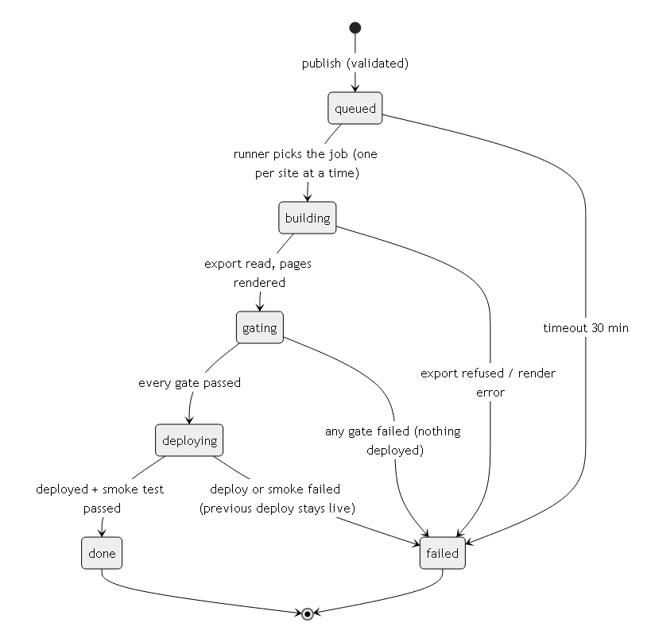

# 07 Specifications: data, API, jobs and events, error codes

## 1. Data (ERD)
Schema: `supabase/migrations/20261028000001_platform.sql` (tested by `supabase/tests/run-local.mjs`). Diagram and table notes:
`02-BACKEND.md` section 1 (`diagrams/10-erd.png`). Content row shapes: the site contract (`contracts/README.md`).
Migrations are forward-only and additive by default (`10-DELIVERY.md` section 5).

## 2. API
`specs/openapi.json` (OpenAPI 3.1.2, https://spec.openapis.org/oas/v3.1.2.html): `save`, `publish`, `upload-start`, `upload-finish`, `export-published`, `job-callback`,
`capture-lead`. Database functions called by them: `service.save_as` (-> `private.save_version`), `service.seed_version`, `service.start_publish`, `service.freeze_snapshot`, `service.published_rows`, `service.set_job_state`, `service.reap_stale_jobs`, `service.unpublish`, `service.capture_lead`
(signatures in the migration). Reads from the dashboard go straight to Postgres through supabase-js under RLS (no API layer).
Check: `node docs/blueprint/specs/check-specs.mjs` (refs resolve, unique ids, every operation secured with 2xx + 401).
The site form endpoint `POST https://<site>/api/lead` accepts the `LeadRequest` body and forwards it to `capture-lead` with the
site id and that site's own signature (`X-Site-Signature`, per-site key; headers for `/api/lead` are set in the Worker code because static-asset `_headers` do not apply to Worker responses); it answers `202` / `400` / `429` and never reports success on a preview host.

## 3. Jobs

| Job | Trigger | Concurrency | Timeout | Retries | Idempotency |
|---|---|---|---|---|---|
| publish build (`publish.yml`) | `publish` -> `repository_dispatch {job_id, site_id}` | one per site (`concurrency: group site-<id>, queue: max`; never cancel or replace a waiting publish) | 30 min | none automatic; client presses Publish again | the snapshot {row: version} is frozen when the build starts (what is live + the requested versions); a rerun ships exactly that snapshot; rows go live only when the job is done; a failed job's versions are never shipped by a later job |
| push-lead | insert into `leads` -> pgmq queue `lead_push` | per lead | 30 s per attempt | 1 m, 5 m, 30 m, 2 h, then failed | `lead_pushes` row per attempt; receiver gets `X-Idempotency-Key = lead id` |
| metrics-pull | pg_cron daily 03:30 UTC enqueues one message per workspace | one workspace per invocation | under the 150 s request idle timeout | next day | upsert on (workspace, source, day) |
| sitemap-submit | job `done` on a live site | 1 per site | 1 min | 3 | Search Console accepts resubmits |
| AI ops run (M8) | pg_cron weekly | 1 per workspace | 15 min | none | proposals are draft rows; nothing publishes itself |

## 4. Events (what other parts listen to)
| Event | Emitted by | Payload | Consumers |
|---|---|---|---|
| `content.saved` | `save_version` (audit_log row) | workspace, collection, row, version, actor | dashboard realtime (history), AI ops (later) |
| `content.published` | `service.set_job_state` (job done) | workspace, row, version, actor | publish job creation |
| `job.state_changed` | `service.set_job_state` (one `publish_job_events` row each) | job, state, gate summary | dashboard realtime, email to requester on failed/done |
| `lead.received` | `capture_lead` | workspace, lead id, form, page | push queue, email alert, dashboard realtime |
| `lead.push_failed` | push-lead after the last retry | lead id, target, last status | overview to-do, alert to owner |
| `signoff.recorded` | `save_version` with sign_off | workspace, field, ref, staff | audit, sign-off queue |
Transport: Postgres rows + Supabase Realtime for the dashboard; pgmq for work queues. No external event bus in v1.

## 5. Error codes
| Code family | Raised by | HTTP | Client sees |
|---|---|---|---|
| `C-*` (contract) | `validateContract` at generation / staff upload | 422 (staff only) | staff admin: the contract cannot be activated |
| `I-*` (row) | `validateItem` in browser and in `save`/`publish` | 422 | message next to the field in plain words |
| `S-NOT-FOUND` | store / `service.contract_for` / `private.save_version` / `service.start_publish` / `service.set_job_state` | 404 | "Not found" (also for any other workspace's id) |
| `S-ROLE`, `S-OWN-ONLY` | `save_version` | 403 | "You can only change your own listings" etc. |
| `S-LOCKED`, `S-SIGNOFF` | `save_version` | 403 | "This text is locked; ask Omnikom to change it" |
| `S-JOB-STATE` | `service.set_job_state`, `service.published_rows` | 409 | technical (illegal transition, snapshot not frozen) |
| `S-AUTH` | `service.use_claims` | 401 | "Please sign in again" |
| `I-MEDIA-UNKNOWN` | `validateItem` with the media lookup | 422 | "This photo was not uploaded here; upload it again" |
| `S-SINGLETON` | `save_version`, `service.seed_version` | 409 | "There is already one; edit it" |
| `S-KIND`, `S-COLLECTION`, `S-SEED-ACTOR` | `service.start_publish`, `save_version`, `service.seed_version` | 422 | technical, shown to staff |
| `VALIDATION` | function input checks | 400 | "Something is missing" with fields |
| `RATE_LIMITED` | capture-lead | 429 | form shows "please try again in a minute" |
The full list with each message: `contracts/README.md` (C-/I-/S- codes, each has a test) and the migration (`raise exception`
messages start with the code).
