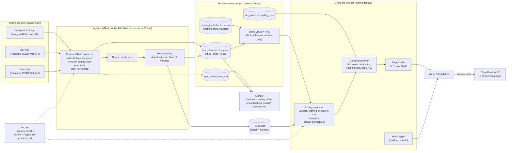

# MLS listings feature: architecture (v0.1, 2026-10-27)

Status: DRAFT, nothing built, no credentials exist. Fits the platform's decided stack (DECISIONS.md 7, 9, 11): one multi-tenant
**Supabase** Postgres, client sites deployed as **Cloudflare Workers with static assets** on one Omnikom account, Node `.mjs`
tools in files, secrets in `.secrets/`. Requirements: `REQUIREMENTS.md`. Procedure: `sops/listings-feed.md`. Evidence:
`research/01-06`. Diagram: `architecture.svg` (same content as the Mermaid below).

## 1. The shape in one paragraph
One **connector per MLS source** pulls listings, media references, members, offices and open houses over the RESO Web API (OData)
into a **per-source store** in Supabase. A **media pipeline** downloads every photo once into Cloudflare **R2** and makes the two
sizes the design uses. A **tenant layer** says which client may show which source, under which **rule set** (disclaimer,
attribution, statuses, field allowlist). The client's site Worker renders search, city and listing pages **server-side** from a
read-only **listings API**, caches them at the edge for minutes, keeps SEO pages indexable and filtered pages out of the index,
and posts leads into the tenant's lead inbox. A **monitor** watches freshness, counts, photo backlog and rate limits, and produces
the monthly customer list each MLS asks for.

## 2. Diagram (Mermaid)

## 3. Components

### 3.1 Sources and connectors (`tools/listings/connectors/`)
- **One `mls_source` row per licence**: `id` (e.g. `bridgemls-idx`, `bareis-idx`, `metrolist-idx`), `platform` (`paragon`,
  `rapattoni`, `bridge`, `trestle`, `mlsgrid`, `rets`), `base_url`, `auth` (`static_bearer` | `oauth2_client_credentials` |
  `oauth2_password` | `rets`), `page_size`, `incremental_field` (`ModificationTimestamp` by default; Bridge:
  `BridgeModificationTimestamp`), `delete_strategy` (`status_only` | `key_sweep` | `flag:MlgCanView`), `media_strategy`
  (`inline` | `media_resource` | `expand`), `rate_limit` (req/s, req/h), `display_rules` (JSON, section 3.5), `rules_version`,
  `rules_confirmed_by` + date.
- **The connector is generic OData** (research/04): follow `@odata.nextLink`, treat `$top` as a hint, `$select` the allowlist,
  upsert on `(source_id, ListingKey)`, overlap each incremental window by 5 minutes (idempotent upserts), store the greatest
  timestamp seen as the high-water mark even for discarded records, ISO-8601 UTC everywhere, back off on 429 / 403-as-throttle.
- **Auth strategies** are the only platform-specific code: Bridge static server token; Trestle OAuth2 client credentials
  (`scope=api`, refresh by `expires_in`); MLS Grid long-lived bearer; **Rapattoni** (BAREIS, MetroList) OAuth2 with the grant the
  MLS issues (password / auth-code / client-credentials are all documented by Rapattoni; which one we get is known after approval);
  **Paragon** (bridgeMLS family) RESO Web API via "Property Information Central" (REPORTED, research/01 2.6): confirm the grant with
  bridgeMLS support. **RETS** is a named slot, NOT built in v1 (reported as BLOCKED if an MLS only offers RETS; what unblocks it: a
  RETS client package vetted under the supply-chain rules, or an API vendor in the middle).
- **Two runtimes, one code**: the connector package is plain JavaScript using `fetch` only, so (a) `node tools/listings/sync.mjs
  --source <id> --mode backfill|incremental|sweep|media` runs the long initial backfill and any ops job from a machine, and (b) the
  same module runs inside a **Cloudflare Worker cron** every 15 minutes for the incremental window (Workers cron CPU limit is 30 s
  for sub-hour schedules and 10,000 subrequests per run, research/06; an incremental window is a handful of pages). If a window
  ever exceeds the Worker budget the run marks `partial=true` and the next run continues from the same high-water mark; the Node
  path is the fallback. Supabase pg_cron + Edge Functions is the alternative scheduler if the Worker path proves awkward
  (10-minute job limit).
- **Initial backfill**: partition by `PropertyType` x `StandardStatus` x price band so each partition stays under any server
  skip-cap (Bridge: 10,000); run from Node; expect hours, not minutes, for photos.
- **Deletes**: status change is the normal path (Closed / Expired / Withdrawn / Canceled). A **daily key sweep** (`$select=ListingKey`
  paged) tombstones keys missing from the remote set, guarded: abort the sweep and alert if it is incomplete or the remote count
  drops more than 20 % against yesterday. Flag-based feeds (MLS Grid `MlgCanView=false`, 7-day retention) use the flag and force a
  full resync after any gap over 7 days.

### 3.2 Media pipeline
- Every photo is **downloaded once** into R2 at `<source_id>/<ListingKey>/<MediaKey>.<ext>` with its SHA-256 and size in the
  `media` row; two variants (card 640 px, detail 1600 px) are generated at ingest by the media worker (research/06: pre-generated
  variants cost about $34/month at the 3-feed planning size vs about $100 for on-demand transformations). MLS URLs are never
  served to a visitor (MLS Grid forbids it and makes URLs single-use; the others are unconfirmed, so one rule for all).
- Trigger: a changed `PhotosChangeTimestamp` / `MediaModificationTimestamp` enqueues a media job (Cloudflare Queues; or a
  `media_job` table polled by the Node runner); download within the hour; a used single-use URL is never retried, the listing is
  re-read instead.
- **Retention**: photos of listings outside the public statuses are deleted after the rule set's window (default 30 days; sold
  windows per rule set) so storage follows active inventory (lean scenario in research/06).

### 3.3 Storage (Supabase, schema `listings`)
| Table | Keys | Notes |
|---|---|---|
| `mls_source` | `id` | platform, auth type, base URL (not secrets), rule set JSON + version + confirmation |
| `listing` | `(source_id, listing_key)` | `raw jsonb` (allowlisted fields only), normalised columns: `listing_id`, `standard_status`, `list_price`, `beds`, `baths`, `sqft`, `lot_sqft`, `year_built`, `property_type`, `property_sub_type`, `city`, `postal_code`, `address_withheld`, `internet_display`, `lat/lng` (+ `geography` index), `public_remarks`, `list_office_name`, `list_agent_name`, `list_agent_phone/email`, `photos_change_ts`, `modification_ts`, `first_seen`, `last_seen`, `deleted_at`, `slug`. Full-text index on remarks + address; GIN on raw |
| `media` | `(source_id, media_key)` | listing_key, order, r2_key, variants, sha256, bytes, fetched_at, deleted_at |
| `member`, `office` | `(source_id, key)` | for attribution (phone / email of the listing participant) |
| `open_house` | `(source_id, key)` | upcoming only on pages |
| `tenant_feed` | `(tenant_id, source_id)` | the licence link: broker participant name + DRE, approval date, agreement file ref, enabled cities / ZIPs, statuses enabled (subset of the rule set), `isolated` flag |
| `sync_state` | `(source_id, resource)` | high-water mark, last sweep, last full backfill, partial flag |
| `sync_run` | `id` | source, mode, window, pages, upserts, deletes, 429s, duration, error |
| `rules_version` | `(source_id, version)` | full JSON history of display rules with who confirmed and when |

- **Tenancy**: a source is shared by every tenant licensed on it (the standard vendor model: one feed per MLS, a monthly customer
  list to the MLS). If an MLS requires a per-website feed, that tenant gets its own `mls_source` row (`isolated=true`) with its own
  credentials; nothing else changes. RLS: the site reads only through `listings.public_listing` views / RPC that join
  `tenant_feed` on the caller's tenant and apply `internet_display`, status and field rules; the anon key can read nothing else.
- **History**: `listing_history(source_id, listing_key, ts, status, price)` for internal freshness checks and the dashboard,
  never rendered publicly unless the rule set allows (price history and DOM are restricted on several MLSs).

### 3.4 Site integration (the client's Worker)
- The platform builds the static site (`build.mjs` -> Workers static assets). Listing routes are handled by the same Worker script
  with `run_worker_first` on `/search*`, `/homes-for-sale-in-*`, `/listing/*`, `/listings-sitemap.xml`, `/api/listings/*`; every
  other path is a static asset. The renderer is a shared package (`packages/listings-render` once the platform has packages;
  `tools/listings/render/` until then) that takes the tenant's design tokens and partials (the ELEV8 section lab
  `lab/sections/listings.html` and `hero.html` become its templates) and returns HTML.
- **Reads** go to Supabase RPC (`search_listings(tenant, filters)`, `get_listing(tenant, key)`, `city_summary(tenant, city)`)
  with the anon key + tenant id; the Worker caches responses in the Cache API for 5-15 minutes (`stale-while-revalidate` up to the
  rule limit), and purges a listing's URLs when its row changes (the sync run calls the purge hook).
- **SEO**: city and detail pages are server-rendered HTML (no client-side-only listing content), self-canonical, in
  `listings-sitemap.xml` (active, allowed listings only, `lastmod` = modification timestamp); search pages with parameters,
  sorts and page 2+ are `noindex,follow`; a removed listing returns **410** (or 301 to the city page if the client prefers) on the
  next cache cycle; JSON-LD per REQUIREMENTS F15.
- **Map**: list + map on the search page; tiles from a self-hosted vector tile set on R2 (Protomaps / PMTiles, to be proven) or a
  provider within its free tier; decided at the first map gate, not before.
- **Leads**: the standard form posts to the tenant's lead endpoint with `listing_key`, `source_id`, URL; lands in the lead inbox;
  pushed to the CRM / OmniSuite by the existing adapter when it exists (DECISIONS 8, 12).

### 3.5 Compliance layer (rules as data)
- `display_rules` JSON per source (keys in REQUIREMENTS section 5). The renderer has **no MLS-specific code**: it reads the rule set
  and (a) prints the disclaimer with the year and the "Data last updated" stamp at the bottom of every page with listing data, (b)
  prints the attribution block in the rule's wording and size, (c) drops any field not in `fields_allowlist` before the template
  sees it, (d) refuses statuses outside `statuses_public` and sold records outside `sold_window_days`, (e) applies
  `max_results_per_query`, (f) hides the address when `address_withheld`, (g) shows the MLS icon where the rule says, (h) never
  puts "MLS" in a URL.
- **Gate** (`tools/listings/compliance-gate.mjs`): renders one search page, one own listing, one other-broker listing, one
  address-withheld listing and one city page per source from fixtures, then asserts every required string, size and absence from
  the rule set (watched-fail: remove the disclaimer in the fixture, see it red, restore). Run before go-live and after every rule
  change; its report is what we send the MLS for the pre-launch check.
- Site-wide items (firm name + DRE numbers on every page, privacy link on every form, TCPA consent text, Equal Housing
  statement) are in the site's base template and checked by the same gate.

### 3.6 Monitoring and ops (`tools/listings/monitor.mjs`, dashboard panel)
- Freshness: alert at 2 h since the last successful run per source; hard red at 50 % of `refresh_max_hours`.
- Counts: active listings per source and per city vs yesterday; a drop over 20 % holds the sweep and alerts.
- Media backlog: pending media jobs older than 1 h; failed downloads with their HTTP codes.
- Rate limits: 429 / throttle count per hour; auto-backoff; never exceed the per-source budget (bridgeMLS vendor agreement: at most
  6 update downloads a day in the current text, full downloads only after 6 pm Mon-Fri: encode as `rate_limit` per source).
- Page health: the platform's render gate on one city page and one listing page per tenant daily.
- Duties: monthly customer list per MLS (by the 5th for bridgeMLS / Bay East) generated from `tenant_feed`; rule-set review when an
  MLS sends a rule change (7 days' notice in the bridgeMLS agreement).

### 3.7 Secrets
- Local tools read `E:\Omnikom Platform\code\main\.secrets\api-keys.env` (git-ignored, `sops/credentials.md`): `MLS_<SOURCE_ID>_BASE_URL`,
  `MLS_<SOURCE_ID>_CLIENT_ID`, `MLS_<SOURCE_ID>_CLIENT_SECRET`, `MLS_<SOURCE_ID>_TOKEN` (whichever the platform issues), saved with
  `tools/save-secret-from-clipboard.ps1`, checked with a one-call `tools/check-api-keys.mjs` extension (`$metadata` or `$top=1`).
- Production: Worker secrets (`wrangler secret put`) for the renderer's Supabase anon key and the sync Worker's MLS credentials;
  Supabase Vault for anything pg_cron needs. The `mls_source` row stores the **name** of the secret, never the value. Rotation:
  regenerate at the platform, save, re-run the check, restart the sync. Logs never print tokens or signed media URLs.

## 4. Data flow, end to end
1. Cron fires for `bareis-idx`: connector loads auth, requests `Property?$filter=ModificationTimestamp gt <hwm-5min>&$select=<allowlist>&$orderby=ModificationTimestamp&$top=<page>`; follows `nextLink`; upserts; records the greatest timestamp; same for `OpenHouse`, `Member`, `Office` on their own marks.
2. Rows whose `PhotosChangeTimestamp` moved enqueue media jobs; the media worker downloads to R2, writes variants, updates `media`, marks stale media deleted.
3. The run writes `sync_run`, updates `sync_state`, calls the site's purge hook with the changed listing URLs and the affected city pages.
4. A visitor opens `/homes-for-sale-in-vacaville-ca/`: edge cache miss -> Worker renders city copy (content contract rows) + `city_summary` + the first page of listings -> compliance layer adds attribution and the disclaimer -> cached 10 minutes -> served. Googlebot sees the same HTML.
5. The visitor opens a listing, sends the enquiry form: lead row with the listing key -> inbox -> CRM push.
6. Nightly: key sweep per source; retention deletes old media; monitor compares counts; the render gate runs on two pages per tenant.
7. Monthly: customer list per MLS from `tenant_feed`; rule-set review.

## 5. Failure modes and what the system does
| Failure | Effect without care | Design response |
|---|---|---|
| MLS endpoint down or 5xx | stale data, broken photos | Pages keep serving from DB + edge cache; freshness alert at 2 h; no partial writes (each page of results is a transaction); photos already in R2 |
| 429 / throttling | banned token | Per-source budget, exponential backoff, run marked partial, next run continues; monitor counts |
| Credentials rotated or revoked | silent empty feed | Auth failure is a hard alert; the high-water mark is not advanced; renderer unaffected |
| Timestamp ties across pages / clock skew | missed records | 5-minute overlap window + idempotent upserts; `$orderby` on the timestamp and key |
| Silent deletes (no flag in feed) | sold homes shown for weeks | Daily key sweep with the 20 % guard; status changes handled in-cycle; 410 on the page |
| Single-use / expiring media URLs | broken images | Download within the hour, never retry a used URL, re-read the listing to get a fresh one |
| Photo backlog after a big backfill | listings without photos | Cards render a placeholder with the count; backlog alert; backfill runs from Node, not inside the cron budget |
| Rule set missing, unconfirmed or stale | MLS violation | Renderer refuses to render listing data for that source until `rules_confirmed_by` is set; compliance gate before go-live and after changes |
| Supabase down | site down | Static pages are unaffected; listing routes serve from edge cache (SWR) then a "temporarily unavailable" page with city copy, never a 500 with no content |
| Count collapse (feed partition missing) | half the inventory vanishes | Sweep aborts on a 20 % drop; alert; nothing deleted until a human looks |
| Worker CPU / subrequest cap in cron | sync never finishes | Runs are bounded per window and resumable; Node path for backfill and recovery |
| MLS changes field names or page size | parser breaks | `$metadata` read at startup, allowlist validated against it, page size taken from the response, run fails loudly on unknown required fields |
| A client leaves | their licence must end | `tenant_feed` row ends; their listing routes stop; the MLS customer list reflects it next month; shared source stays for other tenants |

## 6. What the first week with real credentials measures (before any page is public)
Page size honoured, requests per full pull, whether deletes appear, media URL behaviour (expiry, hot-link policy), field list vs
`$metadata`, timestamp timezone, count vs the MLS's own count for one city (SOP gate V1). Those measurements fill the
`mls_source` row; nothing in this document replaces them.

## 7. Decisions still open (owner)
1. Map tiles: self-hosted vector tiles vs a provider (cost cliff at scale, research/06).
2. Sold pages: build them in v1 (where allowed) or ship Active-only and add later.
3. Interim: keep Brivity on a subdomain until our feed is live, or go without search until then.
4. Scheduler: Worker cron (default) vs Supabase pg_cron for the incremental loop.
