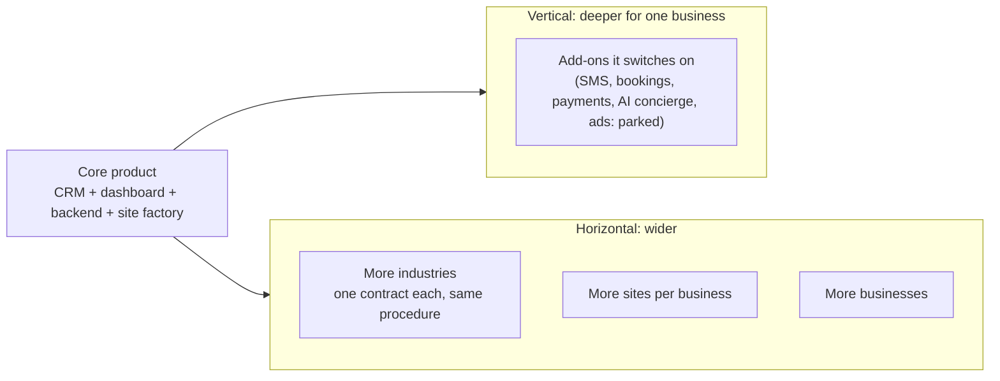

# Expansion

The only place that says how the product grows. Two directions: vertical (more value for one business, through add-ons it
switches on) and horizontal (more industries, more sites, more businesses). The core blocks were built to carry both.

## What makes growth cheap (built)

- One workspace wall in the database: a new business is rows, never a new deployment.
- The contract defines the collections, forms and lead fields, and the screens are generated from it: a new industry needs no
  migration and no screen code. The CRM's industry columns follow from the contract.
- One lead record with one timeline table; jobs with states, events and a reaper; signed machine calls; the key registry.
- The expansion tables of migration 3: `add_ons` (paying, setting-up, active, paused, cancelled), `connectors` (one per outside
  system; no secret in its config), `bookings`, `messages` (consent, quiet hours 21:00 to 08:00 local and daily caps enforced),
  `webhook_events` (one row per provider event), `platform_limits`, with tests and mutants. They stay as built and are not
  extended until a client buys an add-on. (`crm_templates`, built at the same time, is core: `5-crm.md`.)

## Horizontal

| Growth | What it takes |
|---|---|
| A new business | one workspace, its members, a site, a contract from its plan, seed, publish (`omnikom seed workspace`) |
| A second site for a business | one `sites` row and a Pages project; the site switcher appears in the CRM |
| A new industry | a plan and, where the law needs it, a compliance pack in the SEO skill's industry rules; proven by the industry run |
| Many businesses | the measured budget triggers in `2-architecture.md`; about 95 sites per Cloudflare account, then the next account |
| Self-serve sign-up | the presence report as the entry, then payment, then onboarding as a job (later) |

No white label: every site and mail says "powered by Omnikom".

## Vertical: the add-ons (parked)

Each add-on is switched on by a setup wizard of six steps (what it does and costs, pay, what we need, settings, test, done)
that writes one `add_ons` row and one `connectors` row per outside system; every state change is audited.

| Add-on | Shape | Waits on |
|---|---|---|
| AI concierge | OmniSuite calls the new lead within allowed hours, agrees a time and books it; the result returns through a signed webhook into `webhook_events`, then `bookings`; reminders at 24 h and 2 h | the OmniSuite API, voice consent and disclosures |
| SMS and email about a meeting | one send function with templates; SMS only with consent that covers texting, STOP always honoured, quiet hours | an SMS provider and its registration |
| Bookings and calendar | `bookings` with no overlap per team member | a calendar connector |
| Payments | a payment connector | a payment provider |
| Ads | paid ads, only after organic growth levels off | the owner |
| Instagram comment-keyword to message | a lead source into the CRM, never a separate product; needs Meta app review | the owner (noted only) |
| Lead sorting model | a tabular model on the owner's GPU or a small GPU host, once clients have labelled lead outcomes | labelled data |

**OmniSuite** (`E:\Omnisuite final stage the CTO Packets\omnisuite-platform`) is the follow-up engine, rented by API key: voice
agents, sequences, and the convert, cultivate and recover flows run there, not here. Per client it gets a profile and a
knowledge base. Its engine is not yet an API, so nothing connects to it until it is. It is not a push of every lead.

**The rule to unpark:** an add-on is built when a client buys it and the owner unparks it. Until then no add-on tables,
connectors, bookings, messaging or their tests are added.
