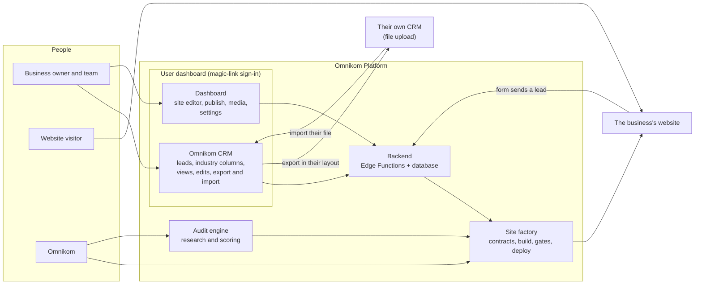
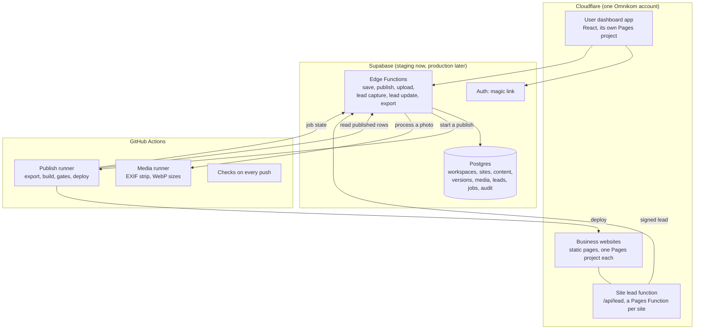
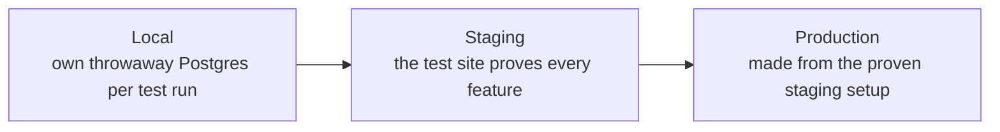

# Architecture

## The whole product

Three kinds of people touch it. The business uses one magic-link sign-in for two products: the Omnikom CRM and the dashboard.
Visitors only ever see the business's website. Omnikom builds and runs everything behind them.

## Where each part runs

| Part | Runs on | Why |
|---|---|---|
| Database, Auth, Storage, Edge Functions | Supabase, region US West | one multi-tenant database with row-level security; no server of our own |
| Business websites | one Cloudflare Pages project per site, all on Omnikom's account | static pages, free preview branches, the Pages Function carries `/api/lead` |
| User dashboard | its own Pages project (`app-staging`, later `app`) | a static single-page app; security lives in the database |
| Builds, photo processing, checks | GitHub Actions | heavy work cannot run in an Edge Function |
| Mail | Resend | sign-in links (Supabase Auth SMTP) and new-lead alerts |
| Domains | the client's registrar points its nameservers at a zone in Omnikom's Cloudflare account | the client keeps ownership; leaving is pointing the nameservers back |

Omnikom holds the running accounts (hosting, deploys, Search Console). The client keeps the domain, content and leads.

## Environments

- **Local:** plain Postgres with a model of Supabase's defaults (`supabase/tests/local-shim.sql`). No Docker, no account.
  Each test harness listens on 127.0.0.1 at its own port block (`11-rules.md`).
- **Staging:** the Supabase project "testing" and the staging Pages projects. Every migration and function lands here first.
  The test site `sites/test-demo-a/` and the CLI journey prove each user-facing feature here (`7-sites.md`, `9-blocks.md`).
- **Production:** not worked on until the backend, the dashboard and the CRM are proven on staging. It is then made from the
  proven staging setup: its own Supabase project, changed only by the owner-run `promote` workflow, which lives in a separate
  private production repository (the working repository never holds a production key) and takes the exact commit to ship.
  `promote` checks production's pending migrations equal staging's proven list, dumps and encrypts first, applies with
  `apply-staging.mjs --i-mean-production`, deploys the same functions and runs read-only smoke checks. Everything else is made by
  `supabase/ops/bring-up.mjs --env production` (row E2): the extensions, every Auth setting, the function secrets the code reads, the
  dashboard's Pages project, domain and build, and the production repository's secrets. It reads first, changes only what differs
  (a dry run unless `--apply --i-mean-production`), and a second run changes nothing; its wanted values live in
  `supabase/ops/environments.json`.
- Production data is never copied down. Every environment has its own keys. Previews are always noindex.

## Budget: free tiers first

The baseline is Supabase Free (two projects: staging and production), Cloudflare Free and Resend Free. The design stays inside
them; nothing is upgraded without the owner's click, and each upgrade has a measured trigger.

| Limit | Free tier | Trigger to upgrade |
|---|---|---|
| Supabase database | 500 MB | production over 350 MB: Supabase Pro |
| Edge Function calls | 500,000 a month | over 400,000 a month: Supabase Pro |
| Realtime | 200 concurrent | over 150 concurrent: Supabase Pro |
| Storage | 1 GB, 50 MB a file | media moves to R2 (10 GB free) |
| Supabase pause | after a quiet week | `keepalive.yml` reads staging every Monday |
| Resend | 3,000 a month, 100 a day | a counter stops at 95 a day; over 80 in one day: Resend Pro |
| Cloudflare Pages | 100 projects an account (about 95 client sites) | the next account is the horizontal step |
| GitHub Actions | free on a public repository | the repository is public until there is budget for a paid plan |

pg_cron and pgmq replace paid queues and schedulers; heavy work runs in the GitHub runner.

## Recovery

At most 24 hours of data lost and back within 4 hours. Nightly encrypted `pg_dump` to Cloudflare R2 plus a second provider,
kept 30 days; a monthly restore drill into a throwaway local Postgres. The dump is encrypted to a public certificate in
`supabase/ops/`; the owner keeps the private key offline. A restore goes into a new project, never over production without the
owner. A bad release is fixed forward and promoted the same way. `backup.yml` is ready and waits on the owner's bucket and key
clicks.

## Targets

Best effort on the free tiers: sites and the form endpoint 99.9%, the dashboard 99.5%, 95% of publish jobs done in 5 minutes.
Nothing is promised to clients until a paid tier.
