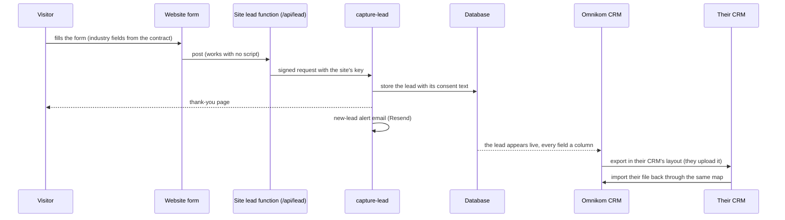
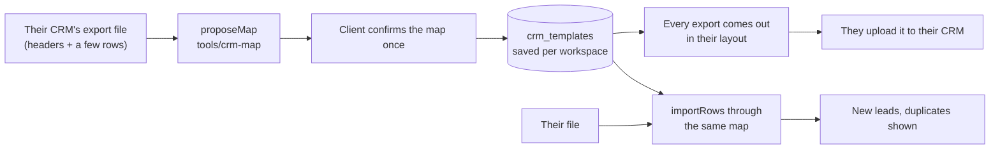

# The Omnikom CRM

The CRM is one of the two products behind the user's magic-link sign-in (the other is the dashboard, `6-dashboard.md`). It is a
full CRM, not an inbox: every lead field is visible and editable, the columns follow the business's industry, and the user
has the views, filters, sorting, bulk edits, notes and history a CRM user expects. A lead reaches the client's own CRM as an
export in that CRM's layout, which they upload, and their file comes back through the same map. There is no automatic push.

Feature states (WORKS, PARTLY, MISSING) live in `1-product.md` Part A and are not repeated here. This file says how each piece
works or must work.

## How a lead travels

1. **Form.** The site's form sends form id, flow, page, cta, assignee, name, email, phone, answers, the consent text the visitor
   saw, marketing consent, a honeypot and an idempotency key made when the form opened. A preview site never fakes success.
2. **Site lead function.** Post only, size cap; a filled honeypot gets 400. A plain browser form (no script) is answered with a
   303 to the thank-you page. It signs the body with the site's key and forwards it to `capture-lead?site=<id>`. Its Pages
   project holds `SITE_ID`, `PLATFORM_BASE` and the secret `SITE_SIGNING_KEY`.
3. **Signature.** `X-Site-Signature: t=<unix>,v1=<hex>`, HMAC-SHA256 over time, method, path with the site id, and body;
   300 s window. Site A's signature fails on site B. A revoked key fails.
4. **Capture.** `service.capture_lead` takes the workspace from the site, never from the body. Refused: no consent text (400),
   unknown site (404), paused site or suspended workspace (409), over the hourly quota (60 a workspace by default, 429).
   The same idempotency key stores nothing new and sends no second alert. The lead, a `received` event and a consent ledger row
   are written in one transaction.
5. **Alert.** One email to the site's alert addresses and, when set, the assigned agent, through Resend, branded with the
   client's name and "powered by Omnikom". A failed alert never fails the lead; it is retried, never the visitor.
6. **In the CRM.** The new row appears live (Realtime, still filtered by RLS).

## The lead record

**Core fields, on every lead:** name, email, phone, form, page (`page_path`), flow, cta, status, owner, consent (the exact
wording, plus marketing and SMS consent), date received. The site the lead came from is shown when a workspace has two or more.

**Industry fields:** every industry contract declares its lead form's fields (`forms.<id>.fields`: type, label, options,
min/max, required, and the flags `column` and `editable`, both true unless the contract says false; `contracts/README.md`).
A realtor's form carries budget, timing and beds, a dentist's insurance and treatment. They are stored in `answers`, keyed as
in the contract, and typed by the database on capture and on every edit (M14): a number is a JSON number, a select value is
one of its options, a key the form does not declare is dropped. `service.lead_list` returns each column under its own key,
typed, with the column list as an array in contract form order; `lead-export` writes one CSV column per field; the record
edits them through `lead-update` `fields`. Nothing is written per industry in code. The CRM's columns follow from the contract.
Not yet: the crm-map dictionary entries and the screens (block 3).

**Status:** new, contacted, qualified, closed, spam today (a fixed list). Spam hides a lead from the default list and deletes nothing.
Owner ruling 2026-11-09 (A16, work order 20): a lead carries two separate columns. **Lead type** is what the lead is about, set from
the form and what the visitor asked, from a list per industry (real estate has about 13 to 15 types; "Enquiry" is one, for a
visitor who is just asking). **Status** is the acquisition state, what happened with the lead: not contacted yet, contacted (and
by whom), not interested, interested in something specific, and so on. The owner's set (2026-11-09 20:48): not contacted yet,
contacted (by whom), answering machine, no answer, voicemail left, wrong number, call back, follow-up, qualified, not qualified,
not interested, interested in something specific, appointment set, do not contact; call back and follow-up carry a date. Both lists are data per industry, never written in code;
SEO and audits research them (work order 29: real estate first, then insurance) and hand the lists to platform build. Today's
five statuses become the status column's starting set or are replaced by a migration (work order 20 decides).

**Who sees what:** the owner sees every lead of the workspace; a member (agent) sees only leads assigned to them. The database
decides, not the screen. A member cannot hand a lead on. A member's hand-entered lead is their own; the owner can pick an owner.

## What the CRM does

| Piece | How it works |
|---|---|
| Lead list | newest first, live; one column per core and industry field; unread rows bold, opening a lead marks it read |
| Lead record | every field visible; every core and industry field editable except the consent record; each edit is an `edited` event with field, old and new value |
| Status and owner | changed in the record or in bulk, with Undo on a single change |
| Notes | up to 2000 characters each, kept in the timeline, never edited or deleted; every note shows its time and its author, the user or the agent (owner, 2026-11-09) |
| Timeline | everything that happened, who, when: received, alert sent or failed, status, assigned, note, edited, exported |
| Add a lead by hand | name, phone, email, how they reached you, what about, notes, and a required tick "the person agreed to be contacted", stored with its date |
| Search | over any column, core or industry, on the server |
| Filter and sort | on any column and value, on the server, under RLS |
| Columns | the user picks which columns a view shows (backend built, work order 18: a view's `columns`; the unsaved choice lives in the page address; screens in work order 19) |
| Saved views | filter, sort and columns saved by name, for the user or shared with the workspace (backend built, work order 18: `crm_views`, `view-save`, `view-delete`; screens in work order 19) |
| Bulk edit | select many, set status, set owner, delete; one event per lead and one audit row |
| Status board | the leads grouped by status, with lead type as a second column; both lists are per-industry data (owner ruling 2026-11-09 above; work order 20) |
| Follow-up | a follow-up date and tasks on a lead, with a "due" filter (backend built, work order 18: `follow_up_at`, `lead_tasks`, `lead-update` `follow_up`, `lead-task`, `lead-list` `due`; screens in work order 19) |
| Duplicates | a new lead with the same email (any case) or phone (any format) as an older lead of the business points at the oldest such lead and is flagged, whichever way it arrived (form, add-lead, import); merging is decided later (backend built, work order 18: `leads.duplicate_of`, `lead-list` `duplicates`; a member sees "a duplicate" but not the other lead unless it is theirs too; leads from before are not flagged; screens in work order 19) |
| Delete | a hard delete, as privacy requires: one or many leads through `leads-bulk` (a single delete is a bulk of one), refused without the explicit confirm flag; one audit row per deleted lead; the consent ledger row stays (legal record) |
| Export | CSV of the current view with every core and industry column, at most 5000 rows, cells starting with `= + - @` guarded; one `exported` event per lead |
| Export in their CRM's layout | see below |
| Import | see below |
| Site switcher | shown only when the workspace has two or more sites |

The CRM features named MISSING in `1-product.md`: A13 choose the columns, A14 saved views, A16 status board, A17 follow-up
date and tasks, A18 duplicates. PARTLY: A2 every field visible, A3 field edit, A9 delete, A10 search, A11 filter, A12 sort,
A15 bulk edit, A19 unread bold, A20 CSV export (no button), A21 export in their layout, A22 import, A24 industry fields as
columns (the backend of A3, A9-A12, A15, A20 and A24 is proven on staging, work order 01, and of A21 and A22, e2e-crm-io 2026-11-04,
work order 02; the screens are built in block 3a, work order 07, and move these rows to WORKS when the staging flows pass).

Delete is a hard delete, as privacy requires (head of operations' ruling 2026-11-03, not an owner question): the row goes,
the consent ledger row stays, one audit row per deleted lead names it (`lead-delete`, with a hash of the email). It needs an
explicit confirm: `service.leads_bulk` refuses a delete without `p_confirm` true (S-CONFIRM); the screen's confirm step is
block 3. The enum kind `deleted` therefore never appears in a timeline.

## Export in the client's layout, and import

The client's CRM stays theirs. Omnikom never connects to it.

- **The map.** `tools/crm-map` (no dependencies, no network, runs in Node and the browser) reads the client's headers and
  sample rows and proposes which of our fields goes in which of their columns: exact synonyms first, then word overlap, a
  capped edit distance and a type check on the samples; a pair below 0.5 is never assigned. Compound headers ("State/Province")
  are tried part by part. Warnings name a non-English sheet, unmapped headers and a semicolon file read as commas.
- **The template.** `{columns: [{header, field, transform}], value_maps}`, saved by `service.save_crm_template` (owner) in
  `crm_templates`. Transforms: first and last name, street, city, state, postal code, phone in E.164 or US form, dates in ISO, US
  or EU form. Our fields are the core lead fields, `owner` (a team member) and the workspace's industry fields in form order
  (`crm_fields`). `crm-map-propose` proposes the map (owner, stores nothing); `crm-template-save` confirms it (owner): every
  industry field it names must be on the business's forms, and saving a name again updates that map. Two templates ship
  (HubSpot, Google Contacts); the HubSpot headers match HubSpot's published property labels (read 2026-11-04), the Google
  headers and both status value maps are not yet checked against a real export.
- **Export.** `lead-export` with a `template` writes the caller's CRM view (the list's search, filters and sort, exactly what
  RLS shows the caller, at most 5000) through `exportRows`: the template's columns in its order, industry columns included,
  phones and dates in the client's form, value maps applied, the formula guard on every cell, one `exported` event per lead.
  Without a template it writes every core and industry field as its own column.
- **Import.** `lead-import` (owner): `parseCsv` (RFC 4180, repeated headers renamed, `;` guessed) then `importRows`, then the
  database types every row as a capture is typed and finds duplicates (same email, any case, or same phone in E.164, against
  the workspace's leads and within the file). A dry run, the default, writes nothing and shows the first 20 rows as they would
  be stored, the rows refused with the line and the field, the duplicates and the warnings. A real run needs skip or add for
  duplicates and is all or nothing: one bad row refuses the file, naming its line. Leads are created with form `import`, owned
  by the owner unless a column names a team member (by name, email or slug), one `received` event and one consent ledger row
  each, one audit row for the call with the file's sha256. A file over the row cap (`4-backend.md`) is refused whole.
- **Consent of imported leads** (settled the way hand-entered leads were): the import is refused unless the owner ticks "These
  people agreed to be contacted by my business"; that sentence, the date and the file's name are each lead's `consent_text`;
  marketing and SMS consent are false.
- **What exists:** the library, the table, the four functions above, backend proven on staging (e2e-crm-io 2026-11-04). **What is
  missing:** the screens (block 3).
  - An imported lead goes on the workspace's oldest site (the plain export and the export event work per site); a business with
    several sites cannot choose another.
  - An import does not read the file's received date, form, page, flow or CTA columns: the lead has form `import` and is received
    now (the report warns once per such column).
- **Removed (work order 08):** the CRM webhook card in Settings, `settings-save`'s CRM part and the `crm-test` function are gone from the
  dashboard, the functions, their tests and the OpenAPI file. `set_crm_webhook`, `crm_secret_put` and the `integrations` table stay,
  called by nothing, until a migration removes them. OmniSuite by API key is the follow-up engine for calls and sequences once its API exists (`10-expansion.md`).

## The test that proves the CRM

Every CRM feature is proven on staging through the test site and the CLI journey (`9-blocks.md`): the test site's contract
must carry an industry form with select, number and choice fields, so the journey can send a lead with industry fields and see
them as columns, edit one, export it in a saved layout and import it back. The test site's contact form carries
budget (number), timing (select), beds (number), area (a select of the site's areas) and buying or selling (choice), drawn
with no script. `supabase/tests/e2e-crm.mjs` proves the backend on staging: a lead posted through the published form, read
back typed, a core and an industry field edited (two `edited` events), a member's edit of a lead not theirs refused, list with
search, filter and sort on budget, bulk status, bulk delete refused without confirm and done with it. Locally the walls are
`supabase/tests/tenancy.test.sql` T22 with their mutants. Status: the staging run has not happened yet (UNPROVEN on staging).
